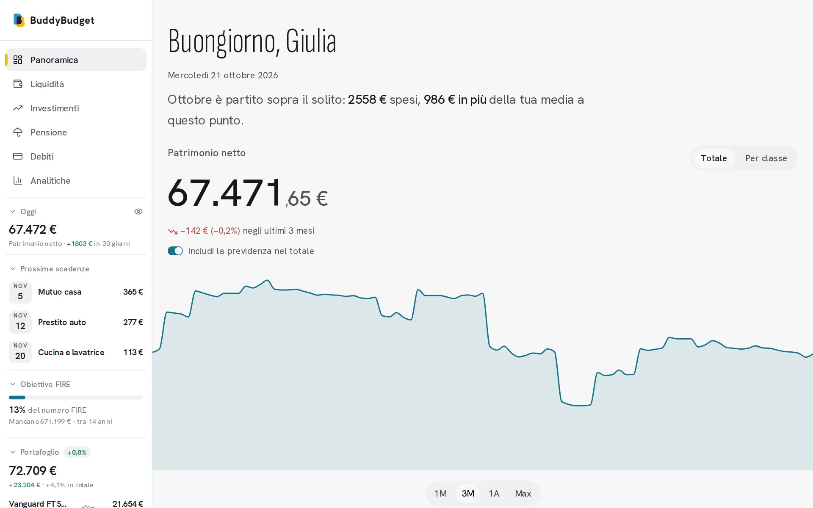
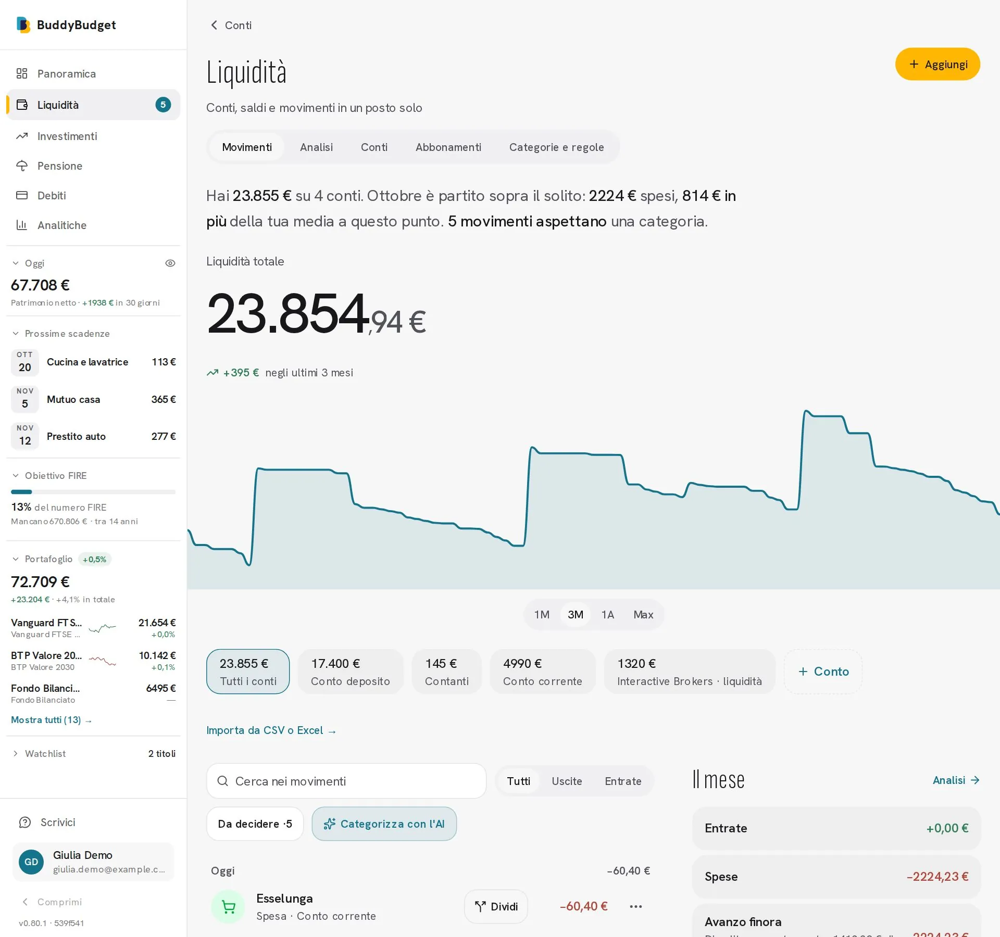
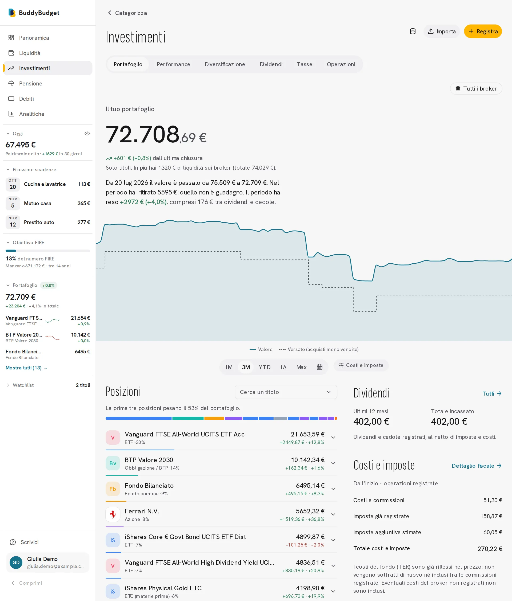
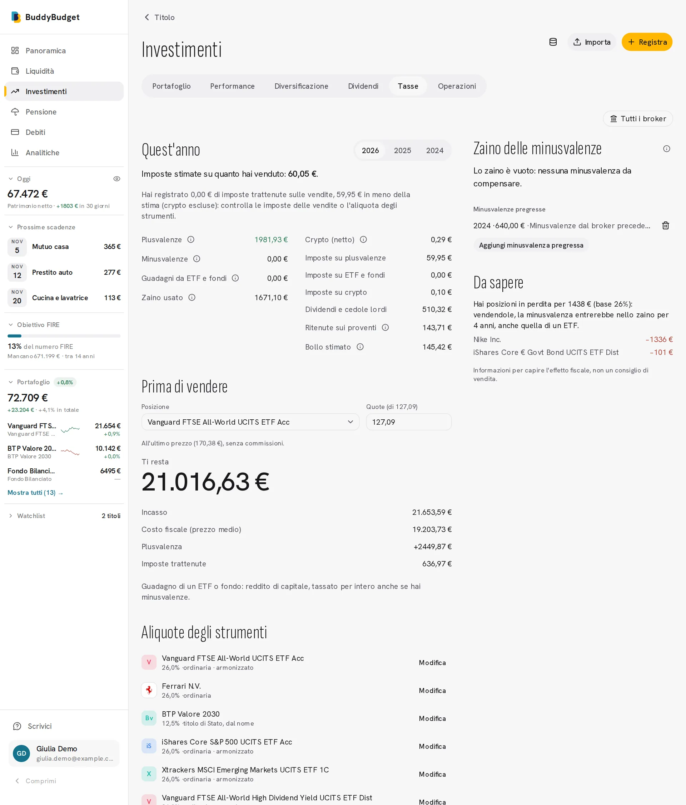
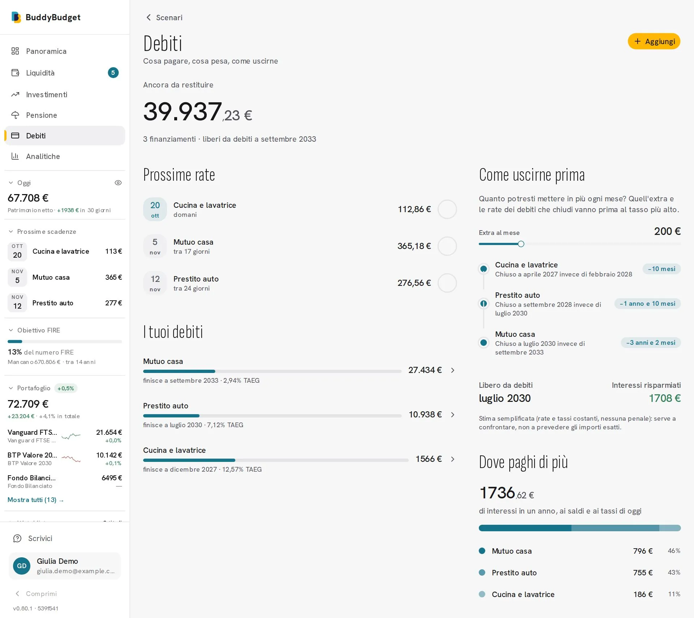
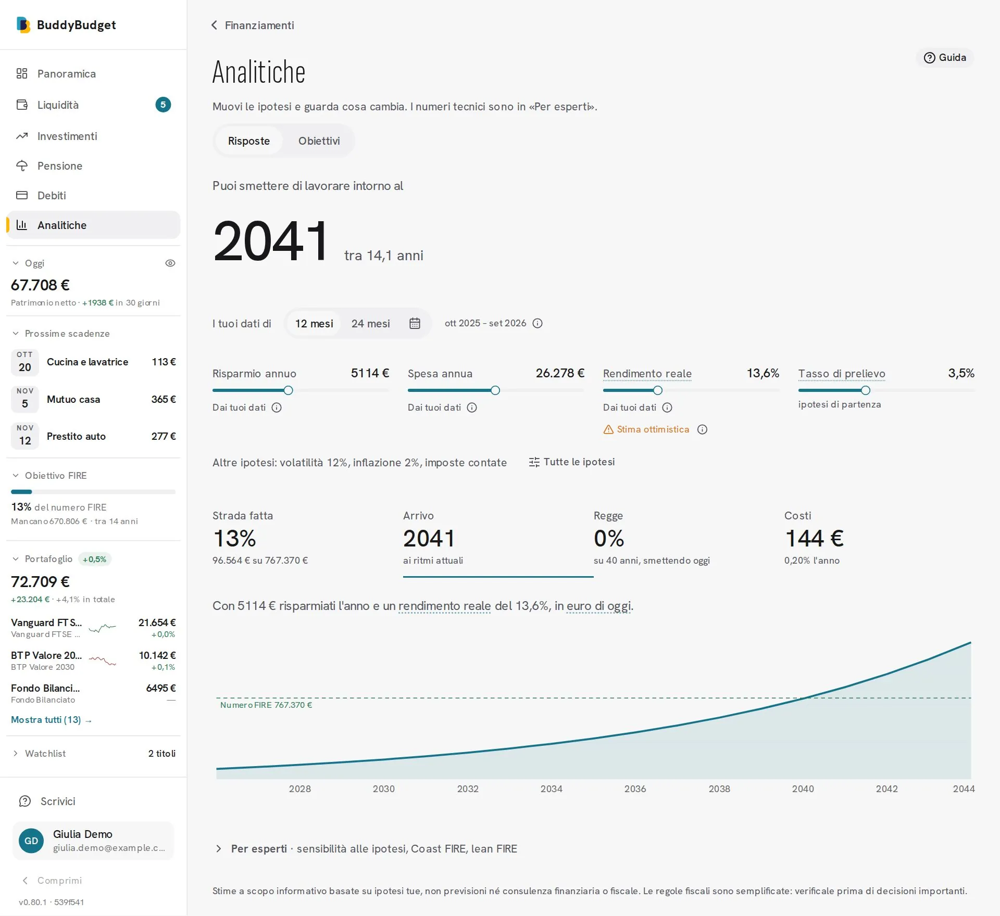
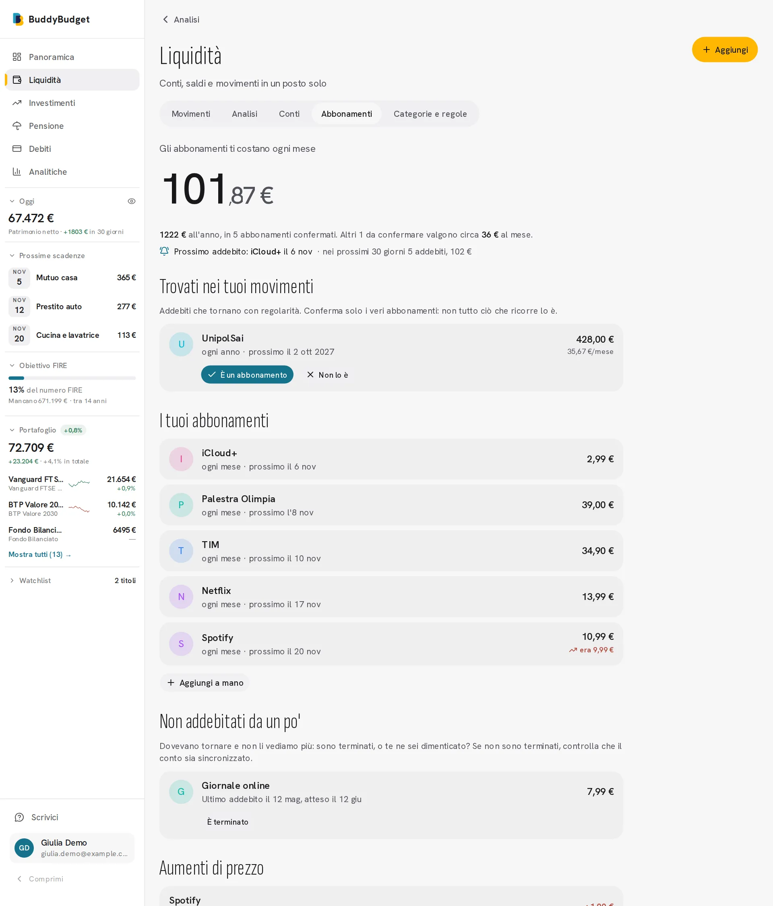

<div align="center">

<picture>
  <source media="(prefers-color-scheme: dark)" srcset="public/brand/logo-full-white.svg">
  
</picture>

<p>Personal finance in one place: accounts and transactions, investments with Italian taxation, debts, pension and net worth over time.</p>

[](https://github.com/YonderUrik/buddy-budget/actions/workflows/ci.yml)
[](https://github.com/YonderUrik/buddy-budget/releases/latest)
[](LICENSE)
[](.github/workflows/ci.yml)
[](https://buymeacoffee.com/yonder)

[Website](https://buddybudget.io) · [Live demo, no sign-up](https://app.buddybudget.io/demo?lang=en) · [Documentation](docs/README.md) · [Self-hosting](docs/self-hosting.md) · [Roadmap](ROADMAP.md) · [Contributing](CONTRIBUTING.md)

</div>

<picture>
  <source media="(prefers-color-scheme: dark)" srcset="landing/public/screens/dark/panoramica-top.webp">
  
</picture>

## Why it exists

Most people who track their money use three tools: an app for expenses, a spreadsheet for investments, another one for the mortgage. BuddyBudget puts them in one app and one net worth, and applies the Italian rules where they change the result: capital gains and losses, the zainetto fiscale (tax-loss carryforward), the lower rate on government bonds, bollo (stamp duty), pension fund taxation.

- It only reads your data. It never moves money.
- Every number comes from a tested function in [`lib/calc/`](lib/calc/), and [`docs/architecture/`](docs/architecture/overview.md) explains how it is calculated.
- You can export or delete everything, or host it yourself with `docker compose`.

## Features

| Area | What you get |
| --- | --- |
| **Panoramica** (Overview) | Net worth over time by asset class, reconstructed history, guided first steps and resettable sample data. |
| **Liquidità** (Cash) | Manual accounts and accounts linked to the bank via Open Banking ([GoCardless](https://gocardless.com/bank-account-data/), read-only); transactions with search, filters, «Dividi» ("Split") and exclusions; categories in four spending groups (Dovute, Volute, Te futuro, Saltuarie — "Needs", "Wants", "Future you", "Occasional") with budgets; rule-based categorisation; month-by-month analysis; subscriptions detected from transactions, with price increases. |
| **Investimenti** (Investments) | ETFs, stocks, BTPs (Italian government bonds), funds and crypto with end-of-day prices from free sources; import from Interactive Brokers, DEGIRO, Trade Republic, Fineco, Yahoo Finance or generic CSV; returns (TWR and XIRR) against an index and net of inflation; risk and look-through diversification inside ETFs; dividends; Italian tax estimate; security page with fundamental indicators, watchlist and price alerts. |
| **Debiti** (Debts) | Loans from origination or from today's situation, amortisation schedule, APR (TAEG), early repayments and simulations (higher instalment, refinancing via surroga, avalanche and snowball). |
| **Pensione** (Pension) | Pension fund and TFR (Italian severance pay): real return, how much you would withdraw today net of taxes, comparison with keeping the TFR at the employer, projection. |
| **Analitiche** (Analytics) | The year you could stop working, with «e se…» ("what if…") sliders on savings, spending, return and withdrawal; for those who want more, FIRE number net of taxes, Monte Carlo and withdrawal rules. |
| **Account** | Sign-in with an email link or Google, summary and alert emails (all optional), installable PWA, light and dark theme, data export and deletion. |

The full list, including what is coming, is in [`lib/features/catalog.ts`](lib/features/catalog.ts): it is the same source from which the website's [Funzioni](https://buddybudget.io/funzioni) (Features) page is generated.

> [!NOTE]
> Tax estimates, projections and simulations are for information only and are not financial or tax advice. The pension rules are assumptions not yet validated by a professional.

<details>
<summary><strong>More screens</strong></summary>
<br>

| Movimenti | Investimenti |
| --- | --- |
|  |  |
| **Tasse** | **Debiti** |
|  |  |
| **Analitiche** | **Abbonamenti** |
|  |  |

These are screenshots of the real app with sample data from a fictitious user, regenerated by a script ([`docs/landing-screens.md`](docs/landing-screens.md)). All screens, including dark theme, are in [`landing/public/screens/`](landing/public/screens/).

</details>

## Try it

### With Docker

App, Postgres, Redis and the scheduled jobs start with a single command:

```bash
git clone https://github.com/YonderUrik/buddy-budget.git
cd buddy-budget
./scripts/selfhost-init.sh   # creates .env with random secrets
docker compose up -d         # then open http://localhost:3000 and create the first account
```

The images are public on ghcr.io (`ghcr.io/yonderurik/buddy-budget`, `latest` follows the latest release; set `BUDDYBUDGET_VERSION` in `.env` to pin one). On an arm64 machine, or to run your own changes, build them from source: `docker compose -f docker-compose.yml -f docker-compose.build.yml up -d --build`.

Sign-in is with email and password, so no mail server is needed; the first account is yours and signups stay closed unless you open them. Email (any SMTP server, or Resend), Google sign-in, AI (OpenRouter) and bank connection (GoCardless) are optional. GoCardless no longer accepts new sign-ups, so on a new install you import bank CSVs instead. The guide [`docs/self-hosting.md`](docs/self-hosting.md) explains what works without external services, how to put the app behind HTTPS, how to update it and how to make backups.

### Local development

You need Node 24, [pnpm](https://pnpm.io), Postgres and Redis.

```bash
pnpm install
cp .env.local.example .env.local   # database, Redis, auth and cron secrets
pnpm db:migrate                    # applies the migrations
pnpm demo:seed                     # optional: fictitious user with sample data
pnpm dev                           # http://localhost:3000
```

Variables are validated at startup by [`lib/env.ts`](lib/env.ts) and commented one by one in [`.env.local.example`](.env.local.example). Google, Resend, GoCardless, price source keys and observability are optional.

| Command | What it does |
| --- | --- |
| `pnpm lint` | ESLint |
| `pnpm exec tsc --noEmit` | type check |
| `pnpm test` | Vitest, on an empty, migrated database (`DATABASE_URL`) |
| `pnpm build` | production build |
| `pnpm db:generate` | new migration after a change to `lib/db/schema/` |

The database schema changes only through versioned, committed migrations, never by hand.

## How it is built

| Layer | Technologies |
| --- | --- |
| **Frontend** | Next.js (App Router), React 19, TypeScript, Tailwind CSS v4, shadcn/ui on `@base-ui/react`, Recharts |
| **Data** | Postgres with Drizzle ORM; Route Handlers as the API, consumed with TanStack Query |
| **Sign-in** | better-auth (magic link and Google OAuth), email with Resend |
| **Long-running work** | background jobs with progress on Redis; cron as `/api/cron/*` endpoints protected by `CRON_SECRET` |
| **Observability** | JSON logs without personal data, Prometheus metrics on `/api/metrics`, product events with Umami |
| **Quality** | Vitest, ESLint, GitHub Actions; versions and CHANGELOG with release-please from PR titles |

```
app/          (auth) sign-in and onboarding · (app) screens · api/ routes and cron
components/   ui/ primitives · layout/ structure · domain/ components per area
lib/          domain per area · calc/ pure, tested calculations · db/ schema and migrations
landing/      static marketing site, a separate Next.js project
scripts/      sample data, screenshots, self-hosting setup
docs/         decisions, specs and plans for each feature, guides
```

Components sit on three layers with dependencies pointing only downwards (`ui` ← `layout`/`domain` ← `app`). Architecture rules, observability and design tokens are in [`CLAUDE.md`](CLAUDE.md): it is also the guide for the AI assistant used in development, but it applies to anyone who contributes.

## Documentation

Start from the [documentation index](docs/README.md). How each number is calculated is in [`docs/architecture/`](docs/architecture/overview.md), why each choice was made is in [`docs/decisioni/`](docs/decisioni/).

## Project status

BuddyBudget is in beta. It is built mostly by one developer with an AI coding assistant. It is made for Italy; Germany is partly supported (partial 2026 German tax estimates; pension, TFR and Analitiche are off). The interface is in Italian, English and German. Bank connections are limited during the beta. What comes next is in the [roadmap](ROADMAP.md).

## Contributing, security and contacts

- **Contributing**: read [`CONTRIBUTING.md`](CONTRIBUTING.md) and the [Code of Conduct](CODE_OF_CONDUCT.md); for a large change, open an issue first. Accessibility status is in [`ACCESSIBILITY.md`](ACCESSIBILITY.md).
- **Vulnerabilities**: do not open a public issue, follow [`SECURITY.md`](SECURITY.md).
- **Support the project**: BuddyBudget is free and built in spare time. If it helps you, you can [buy me a coffee](https://buymeacoffee.com/yonder).
- **Help and reports** about the hosted service: support@buddybudget.io. **Privacy**: privacy@buddybudget.io.

## License

[GNU Affero General Public License v3.0](LICENSE) (AGPL-3.0-only). You may use, study, modify and redistribute the code; if you offer a modified version as a network service, you must make the source available to its users under the same license. The copyright notices and attribution given in [`NOTICE`](NOTICE) must be preserved.
