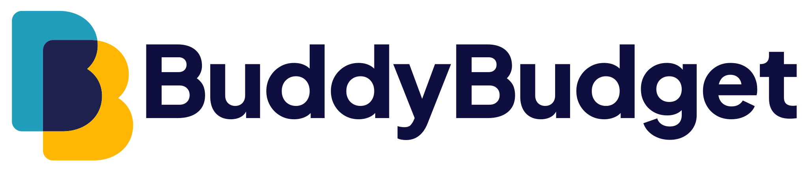
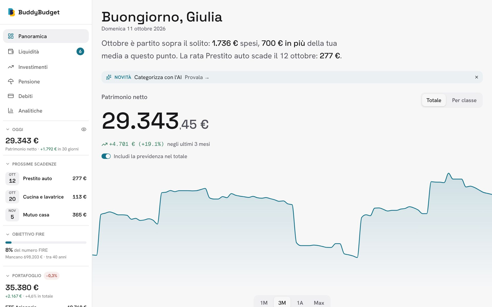
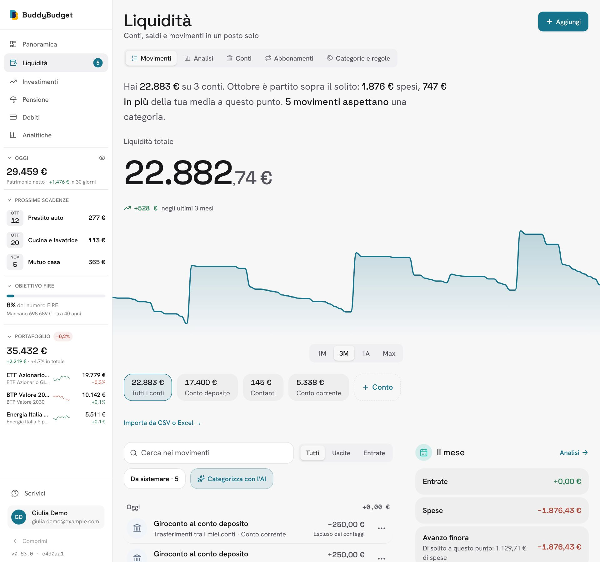
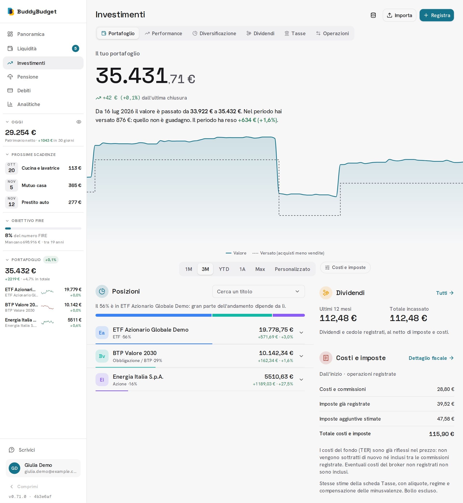
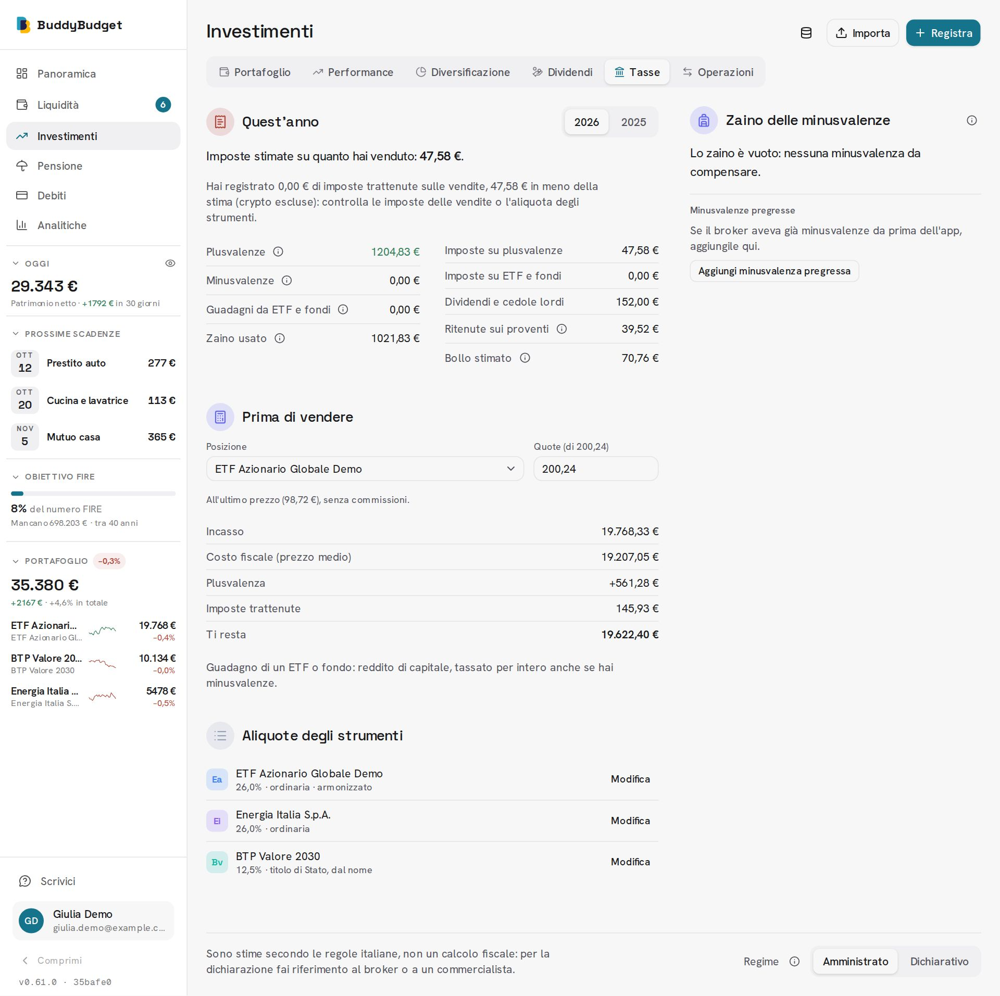
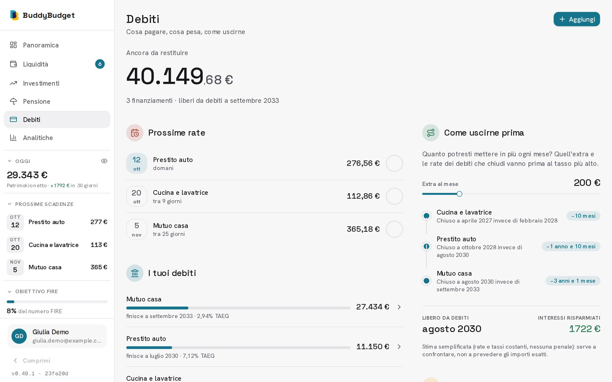
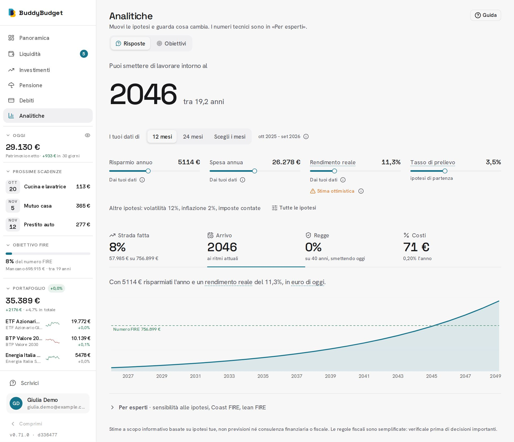
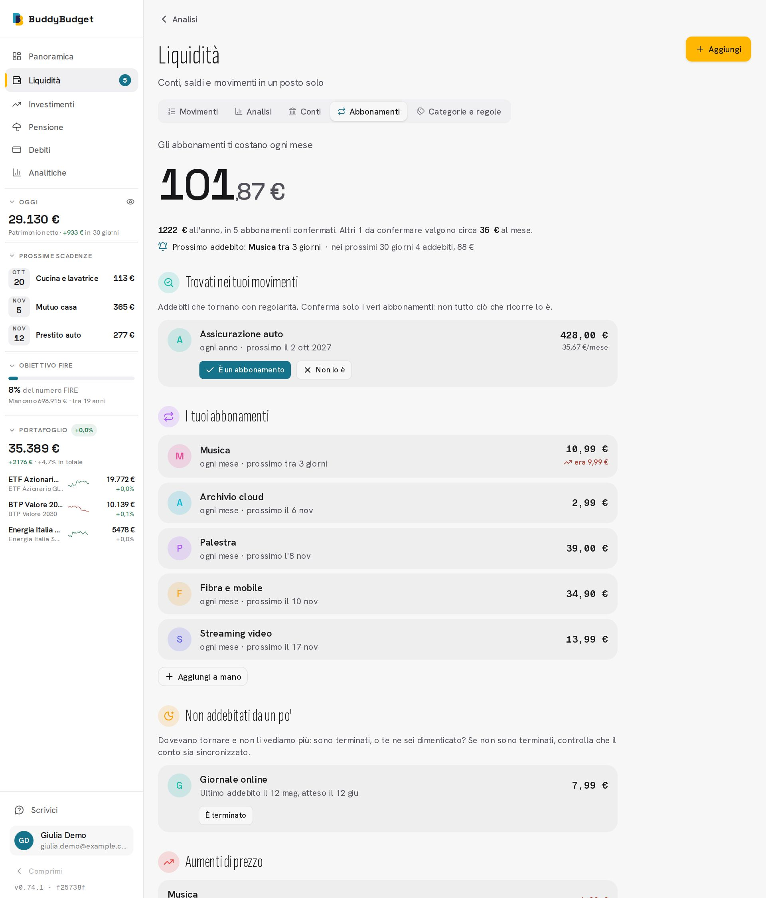

<div align="center">

<picture>
  <source media="(prefers-color-scheme: dark)" srcset="public/brand/logo-full-white.svg">
  
</picture>

<p>Finanza personale in un posto solo: conti e movimenti, investimenti con la fiscalità italiana, debiti, pensione e patrimonio netto nel tempo.</p>

[](https://github.com/YonderUrik/buddy-budget/actions/workflows/ci.yml)
[](https://github.com/YonderUrik/buddy-budget/releases/latest)
[](LICENSE)
[](.github/workflows/ci.yml)

[Sito](https://buddybudget.io) · [Self-hosting](docs/self-hosting.md) · [Sviluppo in locale](#sviluppo-in-locale) · [Contribuire](CONTRIBUTING.md) · [English](#english)

</div>

<picture>
  <source media="(prefers-color-scheme: dark)" srcset="landing/public/screens/dark/panoramica-top.jpg">
  
</picture>

## Perché esiste

Chi tiene i conti di solito usa tre strumenti: un'app per le spese, un foglio per gli investimenti, un altro per il mutuo. BuddyBudget li mette insieme e li collega al patrimonio netto, con le regole italiane dove contano: plus e minusvalenze, zainetto fiscale, aliquota agevolata sui titoli di Stato, bollo, tassazione del fondo pensione.

- **Un solo quadro.** Liquidità, investimenti, previdenza e debiti finiscono nello stesso patrimonio netto, giorno per giorno.
- **Calcoli che si possono controllare.** Rendimenti, imposte e piani di ammortamento vengono da funzioni pure e testate in [`lib/calc/`](lib/calc/); le stime mostrano da cosa partono.
- **Nessuna scelta presa al posto tuo.** Una categoria si applica da sola solo se c'è una regola che hai creato o confermato; le proposte, anche quelle dell'AI, si confermano a mano.
- **I dati restano tuoi.** Esportazione completa in ZIP, eliminazione dell'account, codice aperto e un `docker compose` per ospitarlo da te.

## Funzioni

| Area | Cosa trovi |
| --- | --- |
| **Panoramica** | Patrimonio netto nel tempo per classe di asset, storico ricostruito, primi passi guidati e dati d'esempio azzerabili. |
| **Liquidità** | Conti manuali e collegati alla banca via Open Banking ([GoCardless](https://gocardless.com/bank-account-data/), sola lettura); movimenti con ricerca, filtri, «Dividi» ed esclusioni; categorie in quattro gruppi di spesa (Dovute, Volute, Te futuro, Saltuarie) con budget; categorizzazione a regole; analisi mese per mese; abbonamenti rilevati dai movimenti, con aumenti di prezzo. |
| **Investimenti** | ETF, azioni, BTP, fondi e crypto con prezzi di fine giornata da fonti gratuite; import da Interactive Brokers, DEGIRO, Trade Republic, Fineco, Yahoo Finance o CSV generico; rendimento (TWR e XIRR) contro un indice e al netto dell'inflazione; rischio e diversificazione dentro gli ETF; dividendi; stima delle imposte italiane; scheda titolo con indicatori fondamentali, watchlist e avvisi di prezzo. |
| **Debiti** | Finanziamenti dall'origine o dalla situazione di oggi, piano di ammortamento, TAEG, estinzioni anticipate e simulazioni (rata più alta, surroga, valanga e palla di neve). |
| **Pensione** | Fondo pensione e TFR: rendimento reale, quanto ritireresti oggi al netto delle tasse, confronto con il TFR in azienda, proiezione. |
| **Analitiche** | L'anno in cui potresti smettere di lavorare, con cursori «e se…» su risparmio, spesa, rendimento e prelievo; per chi vuole di più, numero FIRE al netto delle tasse, Monte Carlo e regole di prelievo. |
| **Account** | Accesso con link via email o Google, email di riepilogo e avvisi (tutte facoltative), PWA installabile, tema chiaro e scuro, esportazione ed eliminazione dei dati. |

L'elenco completo, con ciò che è in arrivo, è in [`lib/features/catalog.ts`](lib/features/catalog.ts): è la stessa fonte da cui si genera la pagina [Funzioni](https://buddybudget.io/funzioni) del sito.

> [!NOTE]
> Stime fiscali, proiezioni e simulazioni sono a scopo informativo e non sono consulenza finanziaria o fiscale. Le regole sulla pensione sono ipotesi non ancora validate da un professionista.

<details>
<summary><strong>Altre schermate</strong></summary>
<br>

| Movimenti | Investimenti |
| --- | --- |
|  |  |
| **Tasse** | **Debiti** |
|  |  |
| **Analitiche** | **Abbonamenti** |
|  |  |

Sono screenshot dell'app vera con dati d'esempio di un utente fittizio, rigenerati da uno script ([`docs/landing-screens.md`](docs/landing-screens.md)). Tutte le schermate, anche in tema scuro, sono in [`landing/public/screens/`](landing/public/screens/).

</details>

## Provarlo

### Con Docker

App, Postgres, Redis e i lavori periodici partono con un solo comando:

```bash
git clone https://github.com/YonderUrik/buddy-budget.git
cd buddy-budget
./scripts/selfhost-init.sh   # crea .env con segreti casuali
docker compose up -d         # poi apri http://localhost:3000
```

Finché le immagini non sono pubblicate su ghcr.io, costruiscile dal sorgente: `docker compose -f docker-compose.yml -f docker-compose.build.yml up -d --build`.

Email (Resend), accesso con Google e collegamento alla banca (GoCardless) sono facoltativi: senza Resend il link di accesso compare nei log. La guida [`docs/self-hosting.md`](docs/self-hosting.md) spiega cosa funziona senza servizi esterni, come mettere l'app dietro HTTPS, come aggiornarla e come fare i backup.

### Sviluppo in locale

Servono Node 24, [pnpm](https://pnpm.io), Postgres e Redis.

```bash
pnpm install
cp .env.local.example .env.local   # database, Redis, segreti di accesso e cron
pnpm db:migrate                    # applica le migration
pnpm demo:seed                     # facoltativo: utente fittizio con dati d'esempio
pnpm dev                           # http://localhost:3000
```

Le variabili sono validate all'avvio da [`lib/env.ts`](lib/env.ts) e commentate una per una in [`.env.local.example`](.env.local.example). Google, Resend, GoCardless, le chiavi delle fonti di prezzo e l'osservabilità sono facoltativi.

| Comando | Cosa fa |
| --- | --- |
| `pnpm lint` | ESLint |
| `pnpm exec tsc --noEmit` | controllo dei tipi |
| `pnpm test` | Vitest, su un database vuoto e migrato (`DATABASE_URL`) |
| `pnpm build` | build di produzione |
| `pnpm db:generate` | nuova migration dopo una modifica a `lib/db/schema/` |

Lo schema del database cambia solo con migration versionate e committate, mai a mano.

## Come è fatto

| Livello | Tecnologie |
| --- | --- |
| **Frontend** | Next.js (App Router), React 19, TypeScript, Tailwind CSS v4, shadcn/ui su `@base-ui/react`, Recharts |
| **Dati** | Postgres con Drizzle ORM; Route Handlers come API, consumate con TanStack Query |
| **Accesso** | better-auth (magic link e Google OAuth), email con Resend |
| **Lavori lunghi** | job in background con avanzamento su Redis; cron come endpoint `/api/cron/*` protetti da `CRON_SECRET` |
| **Osservabilità** | log JSON senza dati personali, metriche Prometheus su `/api/metrics`, eventi di prodotto con Umami |
| **Qualità** | Vitest, ESLint, GitHub Actions; versioni e CHANGELOG con release-please dai titoli delle PR |

```
app/          (auth) accesso e onboarding · (app) schermate · api/ route e cron
components/   ui/ primitive · layout/ struttura · domain/ componenti per area
lib/          dominio per area · calc/ calcoli puri e testati · db/ schema e migration
landing/      sito vetrina statico, progetto Next.js a sé
scripts/      dati d'esempio, screenshot, avvio del self-hosting
docs/         decisioni, spec e piani di ogni funzione, guide
```

I componenti stanno su tre livelli con dipendenze solo verso il basso (`ui` ← `layout`/`domain` ← `app`). Regole di architettura, osservabilità e design token sono in [`CLAUDE.md`](CLAUDE.md): è anche la guida dell'assistente AI usato nello sviluppo, ma vale per chiunque contribuisca.

## Documentazione

| Documento | Contenuto |
| --- | --- |
| [`docs/self-hosting.md`](docs/self-hosting.md) | installazione con Docker, HTTPS, aggiornamenti, backup |
| [`docs/product-vision.md`](docs/product-vision.md), [`docs/functional-spec.md`](docs/functional-spec.md) | visione di prodotto e specifica per schermata |
| [`docs/decisioni/`](docs/decisioni/) | perché si è scelto cosa, una decisione per file ([archivio precedente](docs/decision-log.md)) |
| [`docs/superpowers/`](docs/superpowers/) | spec e piano di ogni funzione |
| [`docs/ibkr-import.md`](docs/ibkr-import.md), [`docs/degiro-import.md`](docs/degiro-import.md), [`docs/trade-republic-import.md`](docs/trade-republic-import.md) | import dai broker |
| [`docs/rilasci.md`](docs/rilasci.md) | versioni e rilasci |
| [`CHANGELOG.md`](CHANGELOG.md) | cosa è cambiato in ogni versione |

## Stato del progetto

BuddyBudget è in beta e lo sviluppa una persona sola, con l'aiuto di un assistente AI per il codice. Paese del prodotto e lingua si scelgono separatamente in onboarding e nelle Preferenze: Italia in italiano/inglese, Germania in tedesco/inglese. Per la Germania fiscalità italiana, pensione/TFR, proventi previsionali, Analitiche/FIRE e inflazione italiana sono temporaneamente disabilitati; i dati esistenti sono conservati. Le traduzioni delle email e la revisione dei documenti legali restano separate dall'interfaccia. In arrivo: modelli finanziari tedeschi e notifiche push. Il collegamento alla banca ha posti limitati durante la beta.

## Contribuire, sicurezza e contatti

- **Contribuire**: leggi [`CONTRIBUTING.md`](CONTRIBUTING.md) e il [Codice di condotta](CODE_OF_CONDUCT.md); per una modifica grande apri prima una issue. Lo stato dell'accessibilità è in [`ACCESSIBILITY.md`](ACCESSIBILITY.md).
- **Vulnerabilità**: non aprire una issue pubblica, segui [`SECURITY.md`](SECURITY.md).
- **Aiuto e segnalazioni** sul servizio ospitato: support@buddybudget.io. **Privacy**: privacy@buddybudget.io.

## English

BuddyBudget is a personal finance web app: manual and Open Banking accounts, categorised transactions with budgets and recurring-payment detection, investment tracking (TWR/XIRR returns, benchmarks, risk, look-through diversification, Italian capital-gains tax estimates, broker imports), debts with amortisation and payoff simulations, pension funds, FIRE projections and net worth over time. Product country and interface language are independent: Italy supports Italian and English; Germany supports German and English. Italian tax calculations, pensions/TFR, income forecasts, retirement analytics/FIRE and Italian inflation are disabled for Germany pending dedicated models. Switching country preserves existing records. Email and legal-document localisation remain separate from the app interface.

Self-host it with `./scripts/selfhost-init.sh && docker compose up -d` (see [`docs/self-hosting.md`](docs/self-hosting.md)), or run it for development with Node 24, pnpm, Postgres and Redis: `pnpm install`, copy `.env.local.example` to `.env.local`, `pnpm db:migrate`, `pnpm dev`. Email, Google sign-in and bank connections are optional. Tax and financial figures are informational estimates, not advice.

## Licenza

[GNU Affero General Public License v3.0](LICENSE) (AGPL-3.0-only). Puoi usare, studiare, modificare e ridistribuire il codice; se offri una versione modificata come servizio in rete, devi rendere disponibile il sorgente ai suoi utenti con la stessa licenza. Vanno conservate le note di copyright e l'attribuzione indicate in [`NOTICE`](NOTICE).
