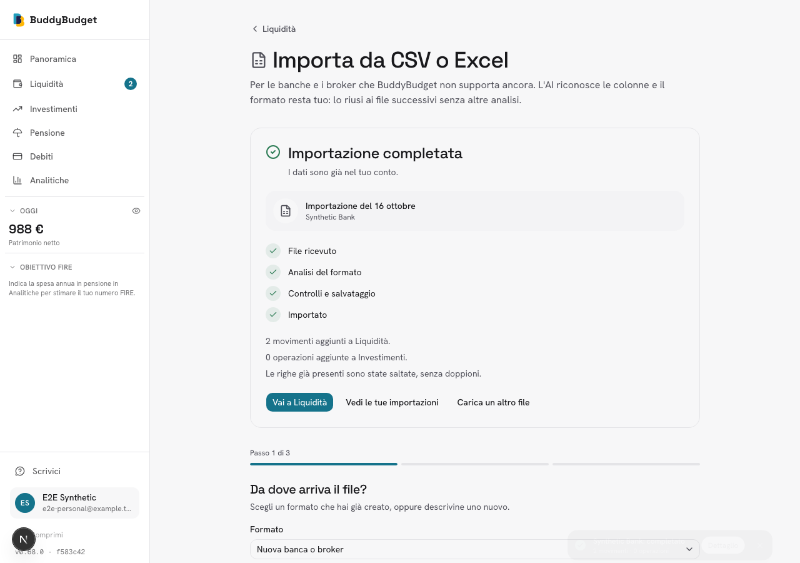
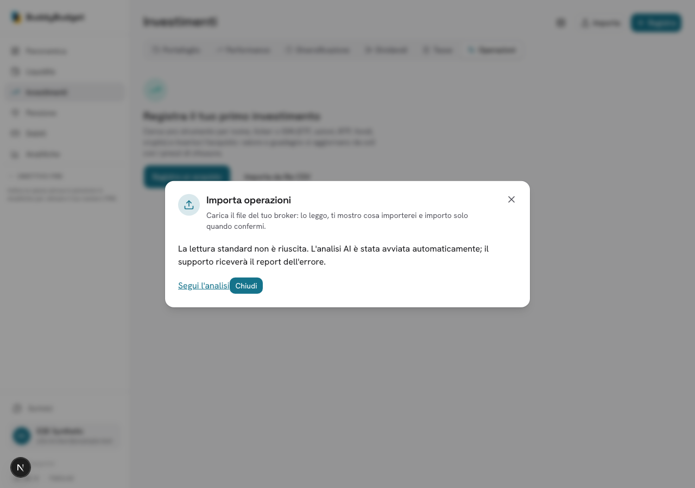
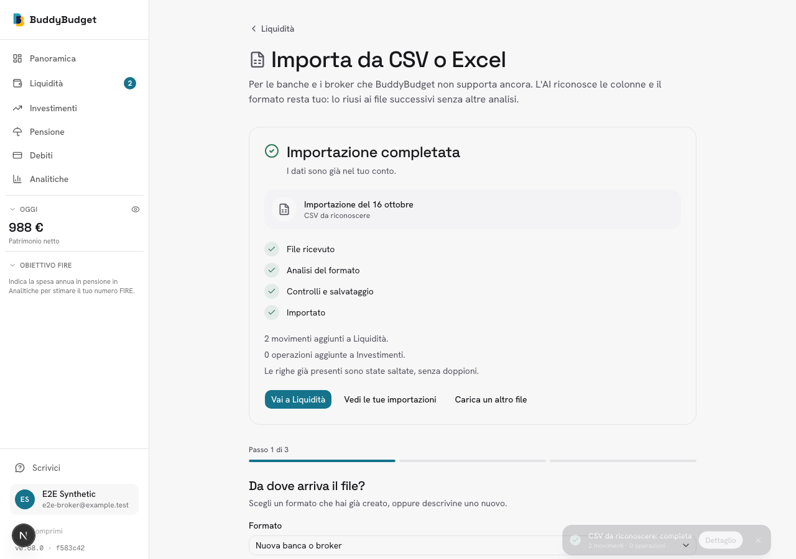

# Import fallback: end-to-end verification

Verified locally on 16 October 2026 (Europe/Berlin), with a real Chromium browser, Next.js app, worker, PostgreSQL, Redis and **real OpenRouter generation**. All inputs and users are synthetic. Resend requests were intercepted in the worker: recipient, body and idempotency key were checked; real email delivery was **not** tested.

## Results

| Scenario | Evidence |
| --- | --- |
| Personal upload using an existing parser that throws | Browser upload accepted (202), automatic AI replacement, final `imported` status |
| Unrecognized CSV uploaded through the broker dialog, with AI consent | Automatic fallback message, durable job, final `imported` status |
| Financial persistence | Exactly two cash movements per user: +1000.00 and -12.50 EUR, total 987.50 EUR |
| Format learning | Institution `Synthetic Bank`, evidence `document`; Date/Amount/Currency/Description columns mapped to normalized fields |
| Payload lifecycle | Raw CSV and preview removed after import; metadata remains |
| Support notification | One captured report per failed import path, addressed to support@buddybudget.io, with original failure reason and idempotency key; no transaction descriptions |

Machine-checked results, job IDs and captured report bodies: [result.json](result.json).





## Defect found and fixed

The first live run generated a personal parser that stripped decimal dots, producing 100000.00 and -1250.00 instead of 1000.00 and -12.50. Comparing actual database amounts caught the problem; completing the UI flow alone would have missed it.

`validateSourceAmounts` now independently compares unambiguous, directly mapped cash amounts with the original CSV before accepting the parser. A mismatch rejects that attempt before financial writes. The prompt also explicitly distinguishes decimal dots and commas. Unit tests cover the observed failure and decimal notation; the database integration test checks that a rejected parser creates neither movements nor a reusable parser.

This guard is deliberately limited: composite amounts, multi-section mappings, ambiguous numeric formats and investment reconciliation are not covered by this comparison. It also depends on declared metadata and does not prove that every AI interpretation is correct. The browser fixture exercises cash imports through both entry points; broker-specific investment histories remain covered by the existing parser/integration suites, not this live fixture.

## Reproduce

Requirements: installed project dependencies, local PostgreSQL and Redis configured in `.env.local`, OpenRouter key/model with ZDR support, Playwright and Chromium. Port 3317 must be free; stop any other Next development process in this checkout first.

```sh
PLAYWRIGHT_MODULE=/absolute/path/to/playwright \
CHROMIUM_PATH=/absolute/path/to/chromium \
node scripts/e2e/run-import-fallback.cjs
```

The runner creates a uniquely named `buddy_e2e_*` database, migrates it, seeds two synthetic sessions and one broken saved parser, starts the app/worker, uploads through the UI, checks persistence and captures screenshots. It drops its database and stops its processes on completion. It makes real AI requests (provider charges apply), but intercepts all worker Resend requests. It never writes production data. Evidence is regenerated in this directory.
