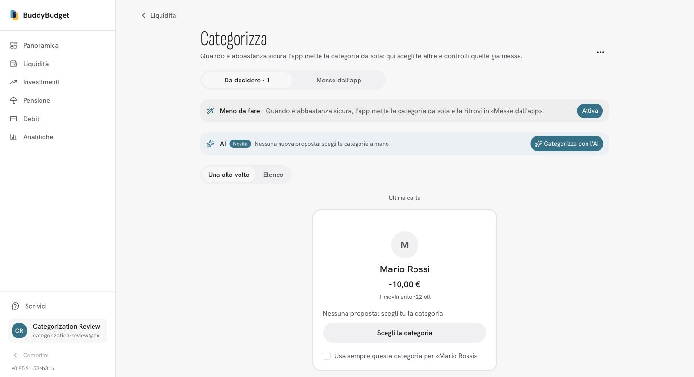

# AI categorization completion regression

All browser evidence uses a synthetic local account, never production expense data.

- Privacy-only case: an invented `Mario Rossi` expense has no suggestion and remains protected. Clicking **Categorizza con l'AI** completes with zero suggestions, restores the enabled button at the first two-second status poll, and shows **Nessuna nuova proposta: scegli le categorie a mano**. The server logs `categorization.ai.skipped` (`no_eligible_merchants`, rejected 1) and `categorization.ai.generation.finished` (`nothing_to_do`, count 0). No provider request is made.
- Provider failures, partial success, user isolation, stale jobs, simultaneous requests and old heartbeats are covered by regression tests against local Postgres/Redis, with the provider mocked.
- Production build (`next build --webpack`), TypeScript and lint checked. Browser verification runs the production build: development webpack currently has an unrelated instrumentation/prom-client `cluster` resolution error.

- Recognized-merchant browser case: adding a synthetic `PAYPAL *TICKETRAUS TIC` makes exactly one merchant eligible (`total: 1`, `blocked: 1` for the protected private name). The local OpenRouter key returns HTTP 401; the server records `failed`, and the next poll re-enables the button and displays **L'assistente si è interrotto. Puoi riprovare.** Successful multi-batch responses are covered with a mocked provider in database integration tests; no production credentials or expense data were copied into the fixture.

Validation: 203 tests in 26 files (categorization domain, Jev client, generation endpoints, localization), TypeScript passes, lint has zero errors (11 existing warnings in unchanged files), production webpack build passes.
