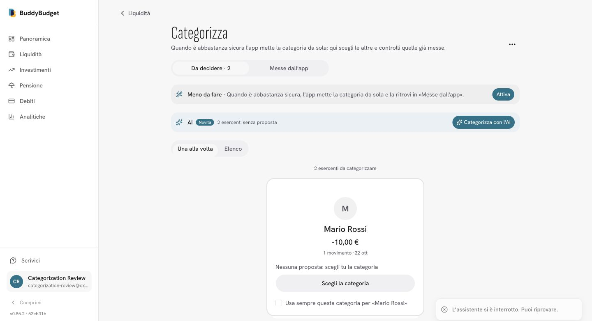

# AI categorization completion and eligibility regression

All browser evidence uses a synthetic local account, never production expense data.

The model input no longer excludes personal names, PayPal payments to people, transfers, withdrawals, salaries or taxes. Regression tests capture the provider request in both batch and single-transaction paths, confirm personal names reach it, include people/operations in examples, and verify transfer categories are available in both directions. Consent, settings, onboarding and the landing security disclosure match this behavior.

Job completion is independent of new suggestions: no-work runs report done with zero results, provider failures report failed, and the button is re-enabled at the first two-second status poll. Local Postgres/Redis tests also cover partial success, user isolation, stale jobs, duplicate requests and old heartbeats. Successful multi-batch replies use a mocked provider; no production credentials or expenses were copied into fixtures.

The browser smoke check used the production build. A local provider authentication error returned a failed job and displayed **L'assistente si è interrotto. Puoi riprovare.**, with the button available again. Development webpack has an unrelated instrumentation/prom-client `cluster` resolution error, so browser checks use the production build.

