# Local test of the personal CSV — October 8, 2026

Local test account, real Trade Republic export of 885 rows, uploaded **as a generic CSV** from the `/importazioni` page. Screenshots with visible data published at the owner's explicit request. The CSV, the provider's responses and the credentials are not included in the repository.

## Outcome

| Step | Evidence |
| --- | --- |
| Upload from the browser | Consent, personal source, asynchronous queue, one-hour estimate and expected time |
| Real generation | `deepseek/deepseek-v4.1-flash`, OpenRouter HTTP 200, `finish_reason=stop`, ZDR mandatory; all 885 rows sent |
| Worker | Analysis succeeded in about 11 seconds; two isolated deterministic runs |
| Independent comparison | 868 movements and 17 investments; zero exclusions/errors; row-by-row comparison with the Trade Republic importer for amounts, dates, movement currencies, quantities/prices/costs/taxes/operation type and ISIN/instrument type |
| Confirmation from the browser | 885 cash entries (868 movements + 17 investment settlements), 17 investment transactions, 885 receipts; dedicated account with balance €975.64, equal to the sum of the movements |
| Second upload and confirmation | Same saved parser, no OpenRouter call; counts and balance unchanged, both jobs imported |
| Cleanup | Encrypted CSV deleted after analysis, encrypted preview deleted after confirmation |
| Final pages | Payments visible in the dedicated account; buys/sells visible in Investimenti ("Investments") → Operazioni ("Transactions") |
| Email | Sending and retry verified in the automated tests with a mocked provider. **Real delivery not verified**: local Resend configuration rejected (HTTP 400); a valid configuration is needed to close this last check |

The database already contained the test of the native Trade Republic importer. The new data belongs to the account `Trade Republic · E2E AI · CSV`; deduplication is per personal format, not across different importers.

## Fixes found during the test

- The provider consumed the budget only in reasoning, without code. DeepSeek's optional reasoning was disabled, the output budget raised to 32,768 and the timeout to 240 seconds; truncated responses are shown as an explicit error.
- Strengthened the instructions on net cash, taxes, rewards and refunds: do not discard credits as presumed duplicates, do not omit tax adjustments. Zero-balance entries allowed.
- Avoided date cutoffs taken from the sample and invented ISIN algorithms; dates and checksums verified by the server.
- Distinguished generic FUND categories from ETFs identifiable by name and identifier.
- Worker errors identify the phase without logging the CSV, the generated code or secrets.

The parser code used in the test was generated by the model, not corrected by hand. The match on this file does not guarantee the correctness of every future parser: the preview with human confirmation remains necessary.

## Automated checks

21 dedicated tests passed (18 contract/sandbox/integration, 3 API); TypeScript and ESLint of the modified files passed. Production build already verified before the worker fixes; not repeated after these fixes. The limitations of the general suite are documented in the PR.

## Screenshots

### Analysis and expected time
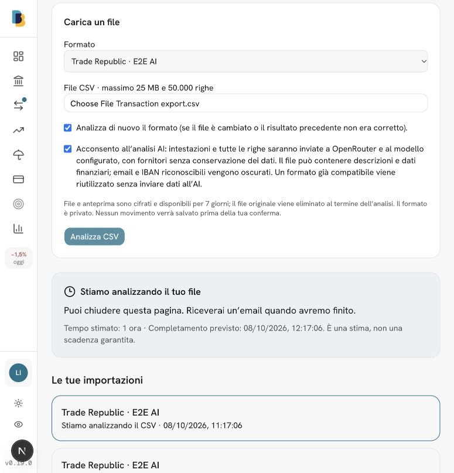

### Preview of all 885 transactions
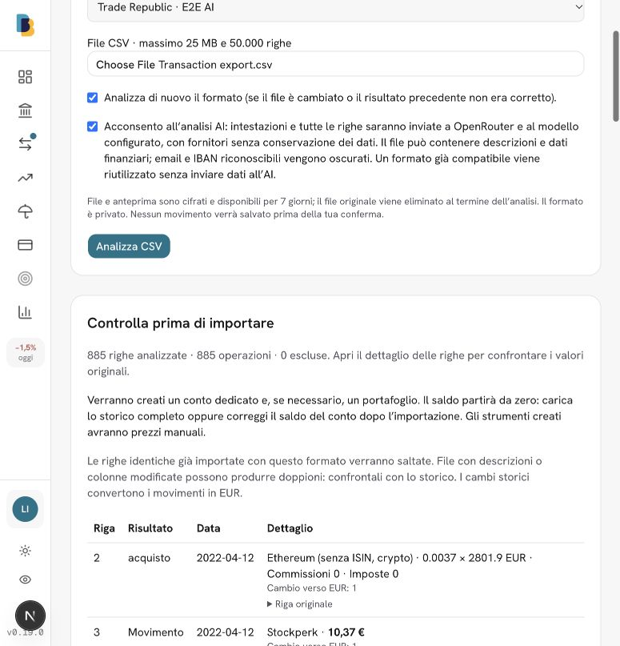

### Import completed
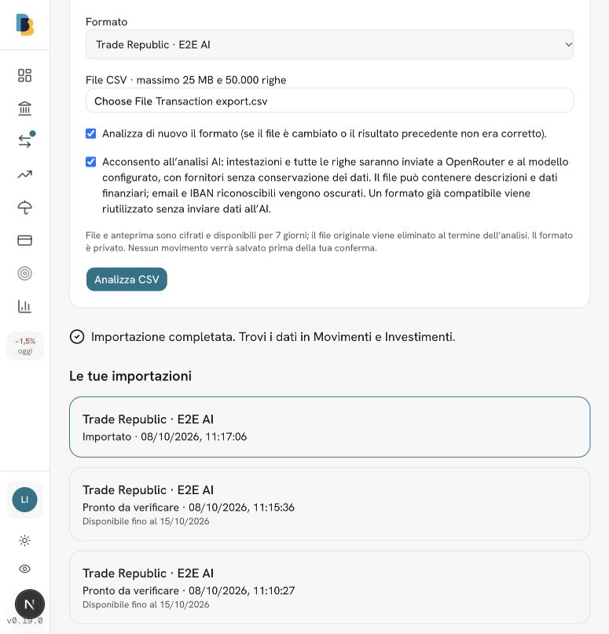

### Second import without new data
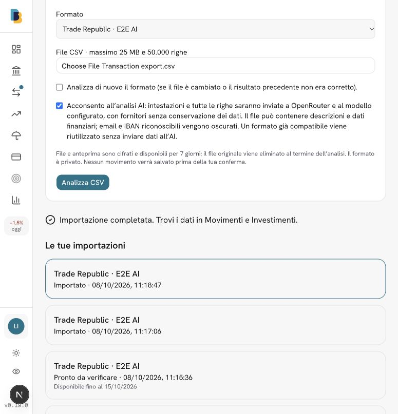

### Payments of the personal account
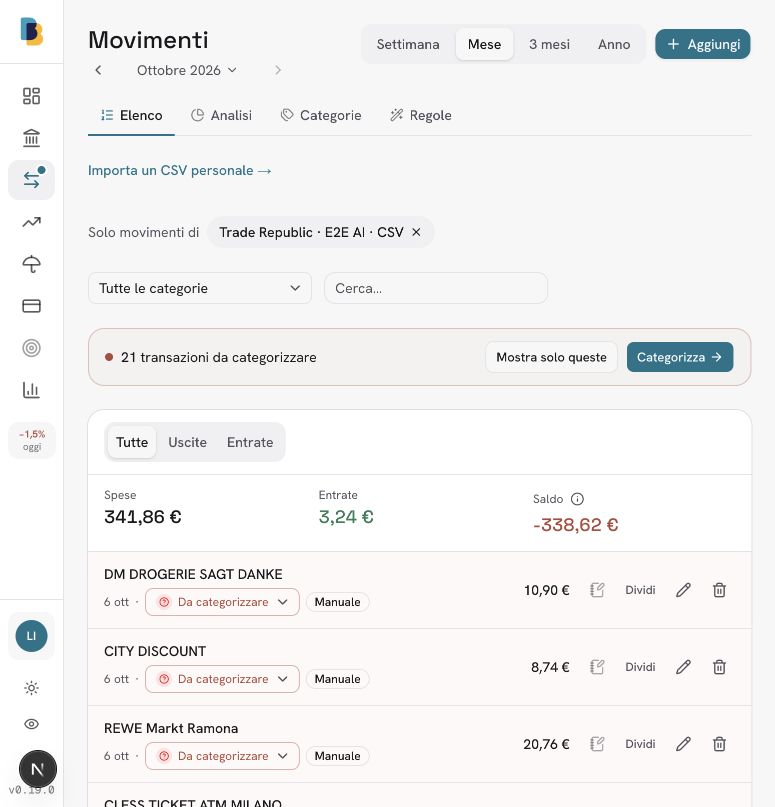

### Account and reconciled balance
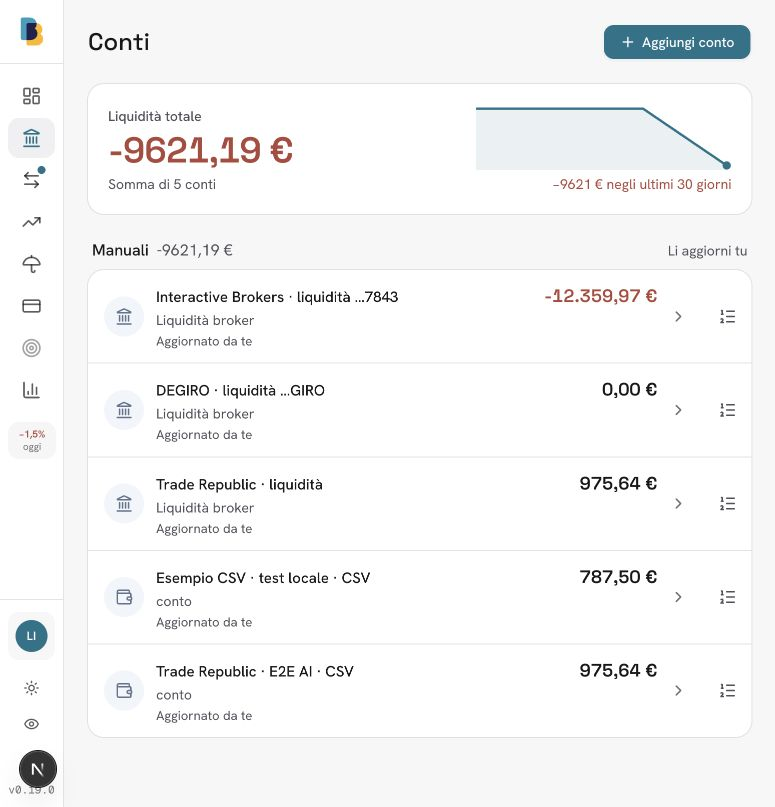

### Investment transactions
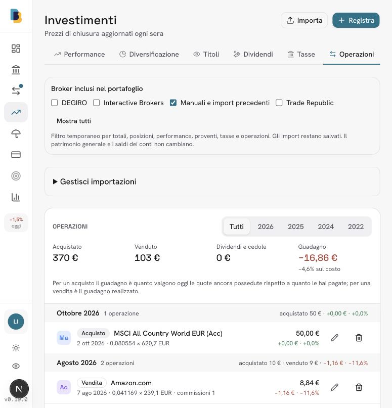

### Personal CSVs in Gestisci importazioni

Verified the list with source/status/date and the link to the correct import from Investimenti → Operazioni → Gestisci importazioni ("Manage imports"). TypeScript and ESLint passed.

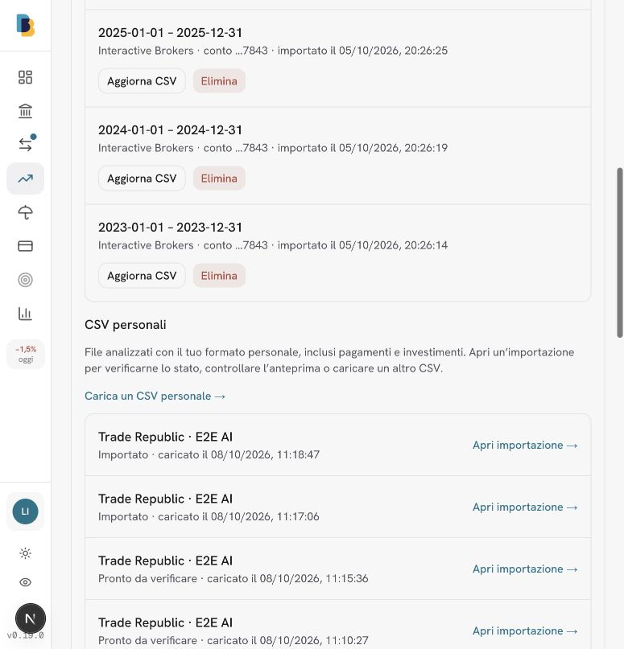

## Unified list and deletion per upload

The separate personal CSV section shown in screenshot 08 was replaced by a single chronological list with the broker statements. The old local personal test data was removed at the user's request; no special deletion path for old imports was added.

26 dedicated tests passed: including deletion of a single upload, preservation of later uploads and parsers, reimport, duplicates, API authorization, stale confirmation and refusal to delete purchases needed by later sales. TypeScript and ESLint passed.

Real test after migration 0024: new Trade Republic upload confirmed from the browser, deletion preview with **885 cash movements and 17 investments**, deletion confirmed from the browser. DB check: zero movements, investments, receipts and jobs for the format; account balance **€0.00**, parsers kept. The six statements of the supported importers remain in the list.

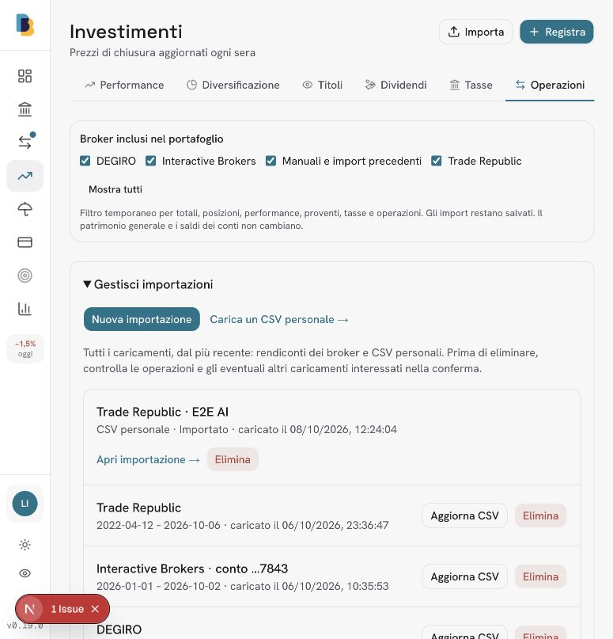
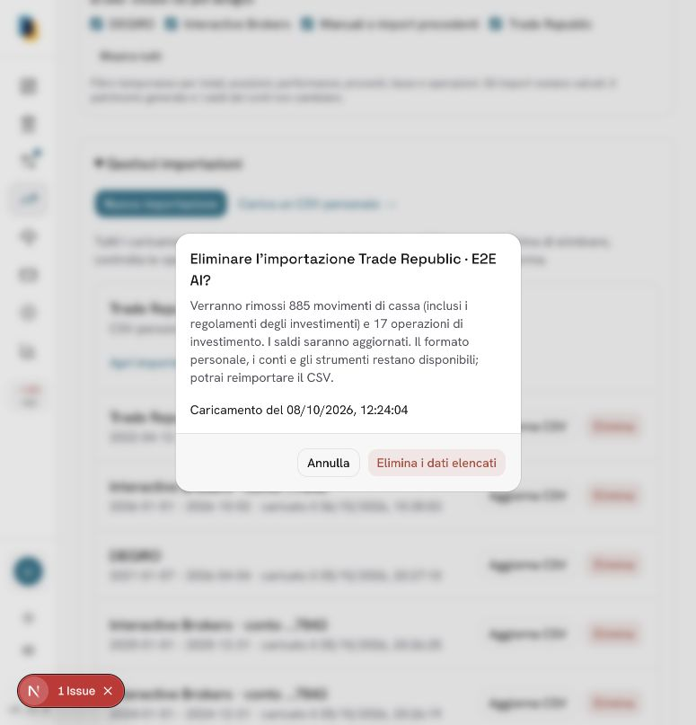
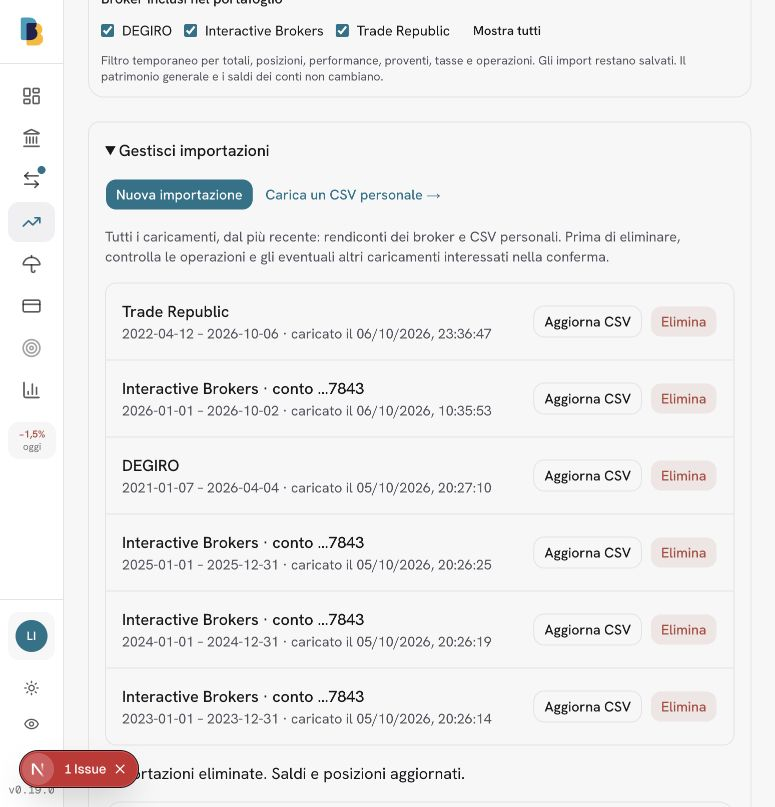

The same CSV was then uploaded again and confirmed using the kept parser. A new deletable import remains available in the local account for manual testing.

### Broker filter after deletion

Empty accounts kept for reimporting no longer add a broker to the filter: at least one transaction, statement or non-zero balance must remain. Verified after a full refresh: only DEGIRO and Interactive Brokers, without the deleted Trade Republic. Nine filter/cash tests passed, including negative balance, zero-balance statement and transactions still present; TypeScript and ESLint passed.

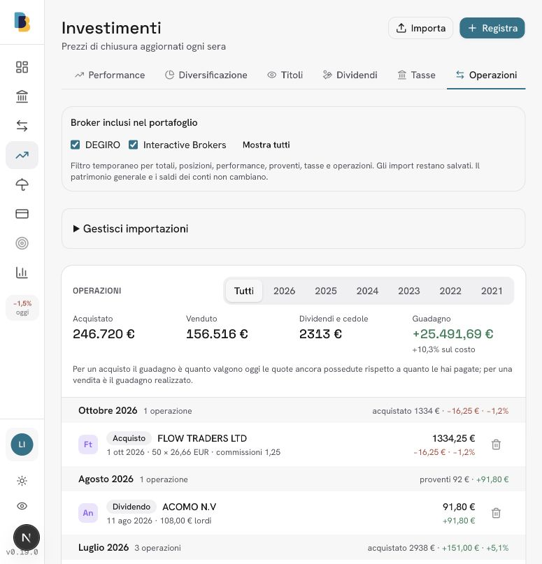

## Raw file interpreted by the AI

Removed the preliminary CSV parsing: the model's input contains only `rawCsv` (unchanged original text) and `sourceName`. No search for headers, delimiters or columns, no Bitpanda rule. The generated parser interprets the document; the row references serve the preview and the check that every row has an outcome. Updated consent: any personal data in the file is included as well, with ZDR mandatory.

Real test from the browser with the Bitpanda file provided by the user: the DeepSeek model generated the parser in about 24 seconds; **51 rows, 45 transactions, 6 justified exclusions, no parsing errors** (5 introductory rows and 1 header). Preview available for the user's review, no financial confirmation performed. This verifies the format analysis; it does not certify the financial correctness of the generated parser. The private file and the generated code are not included in the repository.

27 dedicated tests passed, including the check that the model's payload is exactly the raw file and the source name; TypeScript and ESLint passed.

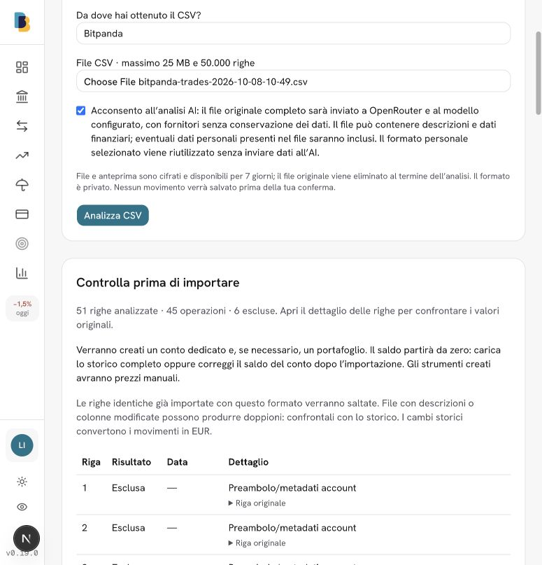

## Automatic saving and source name

Removed the human confirmation: after the analysis the worker saves automatically in an idempotent transaction. The persistent `ready` state allows resuming the save after a restart. Success email only after `imported`; validation errors block everything. 22 targeted tests passed (14 CSV integration and 8 broker filter), TypeScript and ESLint passed.

The local browser shows **Bitpanda** in the broker filter, using the name of the personal format. The previous test job in preview was rejected by the check for a different interpretation of already imported rows; the most recent Bitpanda import remains present, with no automatic overwrites. The successful automatic save and the timing of the email are covered by the integration tests with a mocked provider.

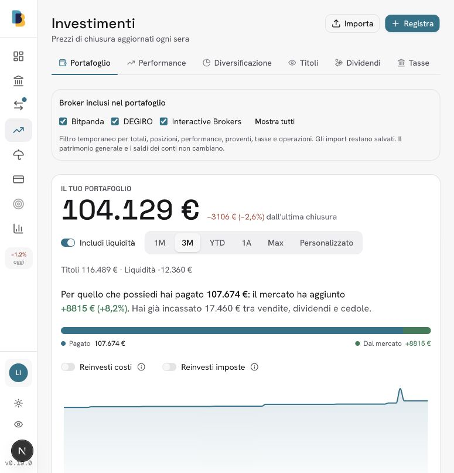
