# Data model

Source of truth: `lib/db/schema/*.ts` (Drizzle ORM, PostgreSQL) in the `buddy-budget` web repo, plus the constant
modules those files import (`lib/investments/constants.ts`, `lib/debts/constants.ts`, `lib/goals/constants.ts`,
`lib/categories/groups.ts`, `lib/categorization/category-source.ts`) and the zod schemas in `lib/validation/*`.

This document describes **persisted entities**. Most API responses are either raw Drizzle rows (e.g. `GET /api/accounts`
returns `accounts` rows verbatim, including `userId`) or view objects computed from them; the per-endpoint docs in
`api/endpoints/` are authoritative for each response shape. Use this file for field semantics, types and enums.

## Serialization rules (apply to every table)

| DB type | JSON type when a row is returned as-is | Example |
|---|---|---|
| `uuid` | string | `"3f9c…-…"` |
| `text` / encrypted text | string | `"Spesa Esselunga"` (encrypted fields arrive **decrypted**) |
| `numeric(p,s)` | **string** (never a JSON number) | `"1234.50"`, `"0.2600"`, `"-35.00"` |
| `integer` | number | `12` |
| `boolean` | boolean | `true` |
| `timestamp with time zone` | string, ISO-8601 UTC with ms | `"2026-10-18T09:12:44.123Z"` |
| `date` | string `YYYY-MM-DD` (no time, no zone) | `"2026-10-01"` |
| `jsonb` | embedded JSON value | object / array |
| nullable column | `null` (key is present, not omitted) | |

Column names: JSON keys are the **camelCase Drizzle property names** (left column of the tables below), never the
snake_case DB names. Exception to watch: `broker_statements.period_from/period_to` are exposed as `from` / `to`.

Request bodies are different: zod schemas accept money as JSON **numbers** (e.g. `balance: 1234.5`), dates as
`"YYYY-MM-DD"` strings. The server converts with `toFixed(2)` etc. So: send numbers, receive strings.

Ownership legend: **user** = row has `userId` FK to `auth_user.id` with `ON DELETE CASCADE` (deleted with the account);
**global** = shared reference data, not per-user; **child of X** = reached through a parent FK.

Encryption at rest: columns declared with `encryptedText(...)` (`lib/db/schema/encrypted-text.ts`) are sealed with
application-level field encryption (`lib/crypto/field-encryption.ts`) on write and opened on read. They are plain
`text` in Postgres, are never filtered/sorted in SQL, and are **transparent to the API** (the client always sends and
receives cleartext). Encrypted columns: `transactions.description`, `transactions.rawDescription`, `transactions.note`,
`debt_events.note`, `goals.name`, `investment_transactions.note`, `investment_tax_carryforwards.note`,
`import_format_profiles.metadata`, `gocardless_token.accessToken`. Separately, `personal_import_jobs.encrypted*` and
`personal_parsers.encryptedParser` are plain `text` columns holding blobs sealed manually by app code
(`seal(..., userId)`); server-internal.

---

## 1. Identity and settings

### `auth_user` — User (`authUser`, `lib/db/schema/auth.ts:4`)
Purpose: the signed-in person; managed by better-auth with custom `additionalFields` (`lib/auth/index.ts:85`).
Ownership: root entity. Deleting it cascades to (almost) every user-owned table.
Exposed to client via the better-auth session (`session.user`, only better-auth core fields + `additionalFields`:
`productCountry, language, currency, onboardingCompleted, homePage, hideAmounts, deletionScheduledAt, legalAcceptedAt,
legalAcceptedVersion`) and via `/api/user/*` routes. All `additionalFields` have `input: false` (not settable through
better-auth sign-up/update; only through app routes).

| Field | DB type | JSON | Null | Default | Client relevance / notes |
|---|---|---|---|---|---|
| id | text PK | string | no | (better-auth generated, not a UUID format guarantee) | user id |
| name | text | string | no | | display name; editable via settings (max `DISPLAY_NAME_MAX_LENGTH`) |
| email | text **unique** | string | no | | login identity (magic link / Google) |
| emailVerified | boolean | boolean | no | false | |
| image | text | string | yes | | avatar URL (Google) |
| productCountry | text | string | no | `"IT"` | **client-critical**: `PRODUCT_COUNTRIES` (`IT`,`DE`); drives country feature gate. Unknown values resolve to `IT` (`resolveProfile`). |
| language | text | string | no | `"it"` | **client-critical**: `LANGUAGES`; must be allowed for the country (`COUNTRY_LANGUAGES`: IT→it,en; DE→en,de) |
| currency | text | string | no | `"EUR"` | **client-critical**: user's base currency; one of `SUPPORTED_CURRENCIES` |
| onboardingCompleted | boolean | boolean | no | false | **client-critical**: false ⇒ show onboarding |
| homePage | text | string | no | `"/panoramica"` | landing page after login; one of `HOME_PAGE_OPTIONS[].path` (web paths; mobile must map) |
| hideAmounts | boolean | boolean | no | false | **client-critical**: mask all money values |
| deletionScheduledAt | timestamptz | string | yes | | **client-critical**: non-null ⇒ account deactivated; API returns 403 except `/api/user/reactivate` |
| legalAcceptedAt | timestamptz | string | yes | | last ToS/Privacy acceptance |
| legalAcceptedVersion | text | string | yes | | **client-critical**: compared to `LEGAL_VERSION` (`lib/legal/version.ts:6`, currently `"2026-10-12"`); mismatch (after onboarding) ⇒ 403 on most APIs until re-accepted |
| movementsSeenAt | timestamptz | string | no | now() | transactions imported after this are "new" ("Da sistemare" badge) |
| startChecklistDismissedAt | timestamptz | string | yes | | "Primi passi" checklist dismissed |
| startChecklistCompletedAt | timestamptz | string | yes | | checklist completed first time |
| aiCategorizationInstructions | text | string | no | `""` | free-text instructions for the AI categorizer |
| aiCategorizationConsentAt | timestamptz | string | yes | | null ⇒ AI categorization off (consent not given) |
| categorizationAutoApply | boolean | boolean | no | true | auto-apply suggestions with confidence ≥ 90% |
| autoCategorizedSeenAt | timestamptz | string | no | now() | auto-categorized after this stay in "Messe dall'app" |
| lastActiveAt | timestamptz | string | no | now() | server-internal (inactivity cron) |
| inactivityWarnedAt | timestamptz | string | yes | | server-internal (inactivity cron) |
| createdAt / updatedAt | timestamptz | string | no | now() | |

Side effect on creation: better-auth `user.create.after` hook seeds the default categories (`defaultCategoryRows`).

### `auth_session` — Session (`authSession`, `auth.ts:45`) — **server-internal**
Ownership: user (cascade). Fields: `id` text PK, `userId`, `token` text **unique** (the session cookie value — never
display/log), `expiresAt` timestamptz, `ipAddress` text? (truncated IP, minimised), `userAgent` text?, `createdAt`,
`updatedAt`. The client only holds the cookie; it never reads this table.

### `auth_account` — Auth provider link (`authAccount`, `auth.ts:58`) — **server-internal**
Ownership: user (cascade). Fields: `id` text PK, `userId`, `accountId` text (provider's user id), `providerId` text
(e.g. `google`), `accessToken`?, `refreshToken`?, `idToken`?, `expiresAt`?, `accessTokenExpiresAt`?,
`refreshTokenExpiresAt`?, `scope`?, `password`? (hash; unused with magic link), `createdAt`, `updatedAt`.
Contains OAuth tokens: never exposed. Not to be confused with the money `accounts` table.

### `auth_verification` — Verification tokens (`authVerification`, `auth.ts:77`) — **server-internal**
Global (no user FK). Fields: `id` text PK, `identifier` text, `value` text (magic-link token), `expiresAt`, `createdAt`,
`updatedAt`.

### `notification_preferences` — Email preferences (`notificationPreferences`, `notifications.ts:8`)
Ownership: user (cascade); **PK = userId** (one row per user, created on first save; absent row ⇒ `NOTIFICATION_DEFAULTS`,
all off).

| Field | DB | JSON | Null | Default | Notes |
|---|---|---|---|---|---|
| userId | text PK/FK | string | no | | |
| digestEnabled | boolean | boolean | no | false | |
| digestFrequency | text | string | no | `"mensile"` | `DIGEST_FREQUENCIES` (validated in app, plain text in DB) |
| budgetAlertsEnabled | boolean | boolean | no | false | |
| deadlineAlertsEnabled | boolean | boolean | no | false | |
| goalAlertsEnabled | boolean | boolean | no | false | |
| createdAt / updatedAt | timestamptz | string | no | now() | |

### `notification_log` — Sent optional emails (`notificationLog`, `notifications.ts:28`) — **server-internal**
Ownership: user (cascade). Fields: `id` uuid PK, `userId`, `kind` text (`NOTIFICATION_KINDS`), `itemKey` text,
`sentAt` timestamptz. Unique `(userId, kind, itemKey)`. Dedup + rate cap; purged after 90 days.

### `analytics_assumptions` — Analytics assumptions (`analyticsAssumptions`, `analytics.ts:9`)
Ownership: user (cascade); **PK = userId**. IT-only feature (country gate on `/api/analytics`).

| Field | DB | JSON | Null | Default | Notes |
|---|---|---|---|---|---|
| userId | text PK/FK | string | no | | |
| data | jsonb | object | no | `{}` | free-form, validated by `lib/analytics/assumptions.ts` (see analytics endpoint doc) |
| walkthroughSeenAt | timestamptz | string | yes | | null ⇒ show first-run walkthrough |
| createdAt / updatedAt | timestamptz | string | no | now() | |

### `financial_plans` — Financial planning document (`financialPlans`, `financial-plans.ts:5`)
Ownership: user (cascade). **Composite PK `(userId, country)`**: one versioned document per user per product country.

| Field | DB | JSON | Null | Default | Notes |
|---|---|---|---|---|---|
| userId | text | string | no | | |
| country | text | string | no | | product country (`IT`/`DE`) |
| data | jsonb | object | no | | free-form plan document (shape owned by `lib/financial-planning`, unverified here) |
| revision | integer | number | no | 0 | optimistic-concurrency revision |
| updatedAt | timestamptz | string | no | now() | |

---

## 2. Liquidity (accounts, transactions, categories, budgets)

### `accounts` — Account (cash/bank account) (`accounts`, `accounts.ts:5`)
Ownership: user (cascade). Referenced by transactions (no cascade: **delete blocked by FK** unless the app deletes
transactions first), bank_account_links (cascade), goal_sources (cascade), broker/statement/personal-format links (set null).

| Field | DB | JSON | Null | Default | Notes |
|---|---|---|---|---|---|
| id | uuid PK | string | no | random | |
| userId | text FK | string | no | | |
| name | text | string | no | | |
| type | text | string | no | | **free text**; UI suggests `ACCOUNT_TYPE_OPTIONS` but any non-empty string is valid |
| balance | numeric(12,2) | **string** | no | `"0"` | current balance in user currency |
| color | text | string | no | `"slate"` | one of `SWATCH_COLORS` |
| icon | text | string | no | `"wallet"` | one of `ACCOUNT_ICONS` (lucide icon names) |
| source | `data_source` enum | string | no | `"manuale"` | `auto` = linked via GoCardless |
| isDemo | boolean | boolean | no | false | sample-data account ("Esplora con dati d'esempio") |
| createdAt / updatedAt | timestamptz | string | no | now() | |

### `transactions` — Transaction / movement (`transactions`, `transactions.ts:14`)
Ownership: user (cascade). FKs `accountId → accounts.id` and `categoryId → categories.id` have **no ON DELETE**
(restrict). Index `(userId, date)`.

| Field | DB | JSON | Null | Default | Notes |
|---|---|---|---|---|---|
| id | uuid PK | string | no | random | |
| userId | text FK | string | no | | |
| accountId | uuid FK | string | no | | |
| categoryId | uuid FK | string | no | | always set (fallback category when uncategorized) |
| description | **encrypted** text | string | no | | may be the cleaned creditor/debtor name for bank imports |
| rawDescription | **encrypted** text | string | yes | | original GoCardless remittance text (tooltip only) |
| merchantCategoryCode | text | string | yes | | 4-digit MCC from bank, informative |
| note | **encrypted** text | string | yes | | user note, max 500 chars (validation) |
| amount | numeric(12,2) | **string** | no | | **signed**: negative = expense, positive = income |
| excludedAmount | numeric(12,2) | **string** | no | `"0"` | "Dividi" (split) part excluded from stats; same sign as amount and `|excluded| ≤ |amount|` (app-level invariant `isValidExcludedAmount`) |
| categorySource | `category_source` enum | string | yes | | who set the category; null = legacy/fallback |
| categoryConfidence | numeric(5,4) | **string** | yes | | 0–1, only for auto-applied suggestions |
| categorizedAt | timestamptz | string | yes | | |
| date | date | string `YYYY-MM-DD` | no | | booking date |
| source | `data_source` enum | string | no | `"manuale"` | |
| externalId | text | string | yes | | GoCardless transaction id (server idempotency); not useful to client |
| createdAt / updatedAt | timestamptz | string | no | now() | |

Unique constraint: `(accountId, externalId)` — only hit by bank sync, not by manual creates (externalId null).
Note the create schema takes a **positive** `amount` plus `direction: "entrata" | "uscita"`; the server stores the sign.

### `categories` — Category (`categories`, `categories.ts:7`)
Ownership: user (cascade). Seeded with defaults at user creation. Referenced by transactions & budgets (restrict),
rules/suggestions (cascade), subscriptions (set null).

| Field | DB | JSON | Null | Default | Notes |
|---|---|---|---|---|---|
| id | uuid PK | string | no | random | |
| userId | text FK | string | no | | |
| name | text | string | no | | |
| defaultKey | text | string | yes | | stable id of app-provided default (for localization); null for custom |
| type | `category_type` enum | string | no | | spending group / income / transfer |
| color | text | string | no | `"slate"` | `SWATCH_COLORS` |
| icon | text | string | no | `"package"` | `CATEGORY_ICONS` |
| description | text | string | yes | | max 120 chars (`CATEGORY_DESCRIPTION_MAX_LENGTH`) |
| isFallback | boolean | boolean | no | false | the "uncategorized" bucket; grouped as `daCategorizzare` |
| createdAt | timestamptz | string | no | now() | (no updatedAt) |

Unique: `categories_user_name_unique (userId, name)` — client **will hit this** when creating/renaming to an existing
name (route maps it to an error; see categories endpoint doc).

### `budgets` — Monthly budget per category (`budgets`, `budgets.ts:5`)
Ownership: user (cascade); `categoryId → categories.id` restrict.

| Field | DB | JSON | Null | Default | Notes |
|---|---|---|---|---|---|
| id | uuid PK | string | no | random | |
| userId | text FK | string | no | | |
| categoryId | uuid FK | string | no | | |
| monthlyAmount | numeric(12,2) | **string** | no | | ≥ 0 |
| createdAt / updatedAt | timestamptz | string | no | now() | |

Unique `budgets_user_category_unique (userId, categoryId)` — the API is an upsert keyed by category.

### `subscriptions` — Recurring subscription decision (`subscriptions`, `subscriptions.ts:14`)
Ownership: user (cascade). Detection is computed on the fly from transactions; only user decisions and manual
subscriptions are stored. Amounts in user currency.

| Field | DB | JSON | Null | Default | Notes |
|---|---|---|---|---|---|
| id | uuid PK | string | no | random | |
| userId | text FK | string | no | | |
| key | text | string | no | | detection key (`subscriptionKey` in `lib/calc/subscriptions.ts`) |
| status | text enum | string | no | `"confermato"` | `SUBSCRIPTION_STATUSES` |
| origin | text enum | string | no | | `rilevato` \| `manuale` |
| name | text | string | yes | | user-chosen name; null ⇒ name from transactions |
| amount | numeric(12,2) | **string** | yes | | declared (manual) |
| cadence | text enum | string | yes | | `SUBSCRIPTION_CADENCES` |
| nextDate | date | string | yes | | declared next charge (manual) |
| categoryId | uuid FK | string | yes | | set null on category delete |
| createdAt / updatedAt | timestamptz | string | no | now() | |

Unique `subscriptions_user_key_unique (userId, key)`.

### `net_worth_snapshots` — Daily net-worth point (`netWorthSnapshots`, `net-worth-snapshots.ts:12`)
Ownership: user (cascade). Written by cron/derivation, read-only for clients.

| Field | DB | JSON | Null | Notes |
|---|---|---|---|---|
| id | uuid PK | string | no | |
| userId | text FK | string | no | |
| date | date | string | no | |
| assetClass | text | string | no | `ASSET_CLASSES` (only `liquidita`, `investimenti` are stored; `previdenza`, `debiti` are computed by the API) |
| amount | numeric(14,2) | **string** | no | `debiti` negative |
| source | text | string | no | `SNAPSHOT_SOURCES` |
| createdAt / updatedAt | timestamptz | string | no | |

Unique `(userId, date, assetClass)`.

---

## 3. Bank connections (GoCardless / PSD2)

### `bank_connections` — Bank connection / consent (`bankConnections`, `bank-connections.ts:13`)
Ownership: user (cascade).

| Field | DB | JSON | Null | Default | Notes |
|---|---|---|---|---|---|
| id | uuid PK | string | no | random | |
| userId | text FK | string | no | | |
| institutionId | text | string | no | | GoCardless institution id |
| institutionName | text | string | no | | |
| requisitionId | text | string | yes | | GoCardless requisition; null while `pending` before the GoCardless call. Server-side identifier — client doesn't need it |
| status | `bank_connection_status` | string | no | `"pending"` | |
| consentExpiresAt | timestamptz | string | yes | | PSD2 consent expiry (show renewal) |
| expiryWarningSentAt / expiredNoticeSentAt | timestamptz | string | yes | | server-internal (email cron) |
| orphanedAt | timestamptz | string | yes | | server-internal (cleanup grace period) |
| createdAt / updatedAt | timestamptz | string | no | now() | |

### `bank_account_links` — Link bank account ↔ app account (`bankAccountLinks`, `bank-connections.ts:38`)
Child of `bank_connections` (cascade) and `accounts` (cascade). No userId.

| Field | DB | JSON | Null | Default | Notes |
|---|---|---|---|---|---|
| id | uuid PK | string | no | | |
| connectionId | uuid FK | string | no | | |
| accountId | uuid FK | string | no | | |
| externalAccountId | text | string | no | | GoCardless account id |
| lastSyncedAt | timestamptz | string | yes | | |
| nextSyncEligibleAt | timestamptz | string | no | now() | earliest manual sync (budget: 4 syncs/day, ≥4h gap) |
| syncTimestamps | jsonb `string[]` | string[] | no | `[]` | last ≤4 ISO sync instants; server-internal |

### `bank_connection_attempts` — **server-internal** (`bank-connections.ts:65`)
Log of GoCardless requisitions for the monthly free-tier cap. `id`, `userId` (nullable, **SET NULL** on user delete —
survives account deletion), `createdAt`.

### `gocardless_token` — **server-internal, global** (`bank-connections.ts:78`)
Single-row cache of the app-level GoCardless access token: `id` text PK, `accessToken` (**encrypted**), `expiresAt`.

### Sync jobs (not a table)
Bank sync progress lives in **Redis** (`lib/sync-jobs/types.ts`), TTL 24h, polled via `/api/sync-jobs`:
`SyncJob { id, userId, kind: SyncJobKind, status: SyncJobStatus, dismissed: boolean, startedAt: ISO, updatedAt: ISO,
accounts: SyncJobAccount[] }` + view field `interrupted: boolean`. `SyncJobAccount { accountId, name, phase:
SyncAccountPhase, total: number|null, processed, inserted, categorized, uncategorized: number, errorReason?:
"already-running" }`. All counts are JSON numbers.

---

## 4. Categorization

### `categorization_rules` — Rule (`categorizationRules`, `categorization-rules.ts:26`)
Ownership: user (cascade); `categoryId` cascade (deleting a category deletes its rules).

| Field | DB | JSON | Null | Default | Notes |
|---|---|---|---|---|---|
| id | uuid PK | string | no | | |
| userId | text FK | string | no | | |
| matchType | `rule_match_type` | string | no | | |
| pattern | text | string | no | | already normalized (`merchantKey`) |
| categoryId | uuid FK | string | no | | |
| splitPercentage | numeric(5,4) | **string** | yes | | fraction 0–1 to exclude ("Dividi"); null = no split |
| source | `rule_source` | string | no | `"appresa"` | |
| hitCount | integer | number | no | 0 | |
| lastAppliedAt | timestamptz | string | yes | | |
| createdAt / updatedAt | timestamptz | string | no | now() | |

Unique `(userId, matchType, pattern)` — client may hit it (409 unless `replaceExisting: true`).

### `categorization_suggestions` — Merchant suggestion memory (`categorizationSuggestions`, `categorization-suggestions.ts:19`)
Ownership: user (cascade); `categoryId` cascade.

| Field | DB | JSON | Null | Default | Notes |
|---|---|---|---|---|---|
| id | uuid PK | string | no | | |
| userId | text FK | string | no | | |
| merchantKey | text | string | no | | normalized merchant key |
| direction | `suggestion_direction` | string | no | | |
| categoryId | uuid FK | string | no | | |
| confidence | numeric(5,4) | **string** | no | | 0–1; 1 if user's choice |
| source | `suggestion_source` | string | no | `"assistente"` | |
| status | `suggestion_status` | string | no | `"in_attesa"` | |
| model | text | string | yes | | LLM model id (internal) |
| promptVersion | integer | number | yes | | internal |
| createdAt | timestamptz | string | no | now() | |
| resolvedAt | timestamptz | string | yes | | |

Unique `(userId, merchantKey, direction)`.

### `categorization_runs` — "Ricategorizza" run, for undo (`categorizationRuns`, `categorization-runs.ts:9`)
Ownership: user (cascade). Fields: `id` uuid, `userId`, `scope` text enum (`tutto` | `regola`), `changed` integer,
`createdAt`, `undoneAt` timestamptz? (non-null ⇒ already undone).

### `categorization_run_items` — **server-internal** (`categorization-runs.ts:28`)
Child of run (cascade) and transaction (cascade); composite PK `(runId, transactionId)`. Fields: `previousCategoryId`
uuid, `previousExcludedAmount` numeric(12,2), `previousSource` `category_source`?, `previousConfidence` numeric(5,4)?,
`previousCategorizedAt`?, `newCategoryId` uuid, `appliedAt` timestamptz.

### `import_format_profiles` — **server-internal** (`importFormatProfiles`, `import-format-profiles.ts:6`)
Ownership: user (cascade). Learned CSV layouts: `id`, `userId`, `fingerprint`, `engine`, `metadata` (**encrypted**,
schema metadata only), `observations` integer (default 1), `createdAt`, `lastSeenAt`. Unique `(userId, engine, fingerprint)`.

---

## 5. Debts

### `debts` — Loan or credit line (`debts`, `debts.ts:17`)
Ownership: user (cascade).

| Field | DB | JSON | Null | Default | Notes |
|---|---|---|---|---|---|
| id | uuid PK | string | no | | |
| userId | text FK | string | no | | |
| kind | text | string | no | `"loan"` | `DEBT_KINDS` |
| name | text | string | no | | max 80 |
| startMode | text | string | no | | `DEBT_START_MODES` |
| principal | numeric(14,2) | **string** | no | | disbursed (nuovo/origine) or current residual (fotografia); credit line: initial drawn |
| annualRate | numeric(7,4) | **string** | no | | TAN in **percent** (e.g. `"3.2500"`); credit line: initial index value |
| installments | integer | number | no | | total (nuovo/origine) or remaining (fotografia); 0 for credit lines |
| firstInstallmentDate | date | string | no | | first (or next for fotografia) due date; credit line: opening date |
| installment | numeric(12,2) | **string** | yes | | declared instalment; null ⇒ computed |
| anchorDate | date | string | yes | | snapshot date (fotografia only; required then) |
| costs | jsonb `DebtCost[]` | array | no | `[]` | `{ label: string, amount: number (JSON number!), kind: "una_tantum"\|"per_rata" }`, max 10 |
| creditLimit | numeric(14,2) | **string** | yes | | credit line only |
| spread | numeric(7,4) | **string** | yes | | percentage points over index |
| indexLabel | text | string | yes | | e.g. "Euribor 3M" |
| interestFrequency | text | string | yes | | `CREDIT_LINE_FREQUENCIES` |
| dayCount | text | string | yes | | `CREDIT_LINE_DAY_COUNTS` (note: string values `"360"`/`"365"`) |
| capitalizeInterest | boolean | boolean | yes | | |
| alertThresholdType | text | string | yes | | `CREDIT_LINE_ALERT_TYPES` |
| alertThresholdValue | numeric(14,2) | **string** | yes | | |
| createdAt / updatedAt | timestamptz | string | no | now() | |

Only `name` and `costs` are editable (`updateDebtSchema`); conditions change only through events.

### `debt_events` — Debt event (`debtEvents`, `debts.ts:59`)
Child of `debts` (cascade); also has `userId` (cascade). `transactionId → transactions.id` **SET NULL**.

| Field | DB | JSON | Null | Notes |
|---|---|---|---|---|
| id | uuid PK | string | no | |
| debtId | uuid FK | string | no | |
| userId | text FK | string | no | |
| type | text | string | no | `DEBT_EVENT_TYPES` |
| date | date | string | no | |
| amount | numeric(14,2) | **string** | yes | paid (payment), real residual (balance_correction), repaid (early_repayment) |
| installmentNumber | integer | number | yes | payment only |
| rate | numeric(7,4) | **string** | yes | new annual rate % (rate_change) |
| penalty | numeric(12,2) | **string** | yes | early_repayment |
| effect | text | string | yes | `DEBT_EARLY_EFFECTS` |
| transactionId | uuid FK | string | yes | manually linked transaction |
| note | **encrypted** text | string | yes | max 500 |
| createdAt | timestamptz | string | no | |

Partial unique index `debt_events_payment_unique (debtId, installmentNumber) WHERE type='payment'` — client **hits this**
when recording the same instalment twice.

---

## 6. Goals (IT only; `/api/goals` country-gated)

### `goals` — Savings goal (`goals`, `goals.ts:15`)
Ownership: user (cascade). Progress is **not stored**: computed from `goal_sources` at today's balances/prices.
Max 20 per user (`MAX_GOALS`).

| Field | DB | JSON | Null | Default | Notes |
|---|---|---|---|---|---|
| id | uuid PK | string | no | | |
| userId | text FK | string | no | | |
| name | **encrypted** text | string | no | | max 80 |
| kind | text | string | no | | `GOAL_KINDS` |
| targetAmount | numeric(14,2) | **string** | no | | > 0 |
| targetDate | date | string | yes | | always the **first day of a month** (input `YYYY-MM` or `YYYY-MM-DD` is normalized) |
| monthlyAmount | numeric(12,2) | **string** | no | `"0"` | planned monthly saving |
| priority | integer | number | no | 0 | order for allocating monthly savings (0..100) |
| achievedAt | timestamptz | string | yes | | marked achieved |
| createdAt / updatedAt | timestamptz | string | no | now() | |

### `goal_sources` — Earmarked part of an account/instrument (`goalSources`, `goals.ts:39`)
Child of `goals` (cascade); `accountId → accounts` cascade; `instrumentId → instruments` cascade; `userId` cascade.
Max 12 per goal.

| Field | DB | JSON | Null | Notes |
|---|---|---|---|---|
| id | uuid PK | string | no | |
| goalId | uuid FK | string | no | |
| userId | text FK | string | no | |
| accountId | uuid FK | string | yes | exactly one of accountId / instrumentId (CHECK `goal_sources_one_target`) |
| instrumentId | uuid FK | string | yes | |
| amount | numeric(14,2) | **string** | no | |
| createdAt | timestamptz | string | no | |

Partial uniques: `(goalId, accountId)` and `(goalId, instrumentId)` — one source per account/instrument per goal.

---

## 7. Pension (IT only; `/api/pension` country-gated)

### `pension_funds` — Supplementary pension fund (`pensionFunds`, `pension.ts:8`)
Ownership: user (cascade). Fields: `id` uuid, `userId`, `name` text (max 80), `adhesionDate` date (first enrolment in any
fund; drives exit tax rate), `createdAt`, `updatedAt`.

### `pension_snapshots` — Fund snapshot (`pensionSnapshots`, `pension.ts:25`)
Child of fund (cascade); `userId` cascade.

| Field | DB | JSON | Null | Notes |
|---|---|---|---|---|
| id | uuid PK | string | no | |
| fundId | uuid FK | string | no | |
| userId | text FK | string | no | |
| date | date | string | no | not in future, ≥ 1950 |
| netContributions | numeric(14,2) | **string** | no | |
| value | numeric(14,2) | **string** | no | market value |
| createdAt | timestamptz | string | no | |

Unique `(fundId, date)` — one snapshot per fund per day; import/creation may hit it.

---

## 8. Investments

### `instruments` — Financial instrument (`instruments`, `investments.ts:32`)
Ownership: **global** (shared by all users), except **private/manual instruments** where `createdByUserId` is set
(visible only to the creator; SET NULL on user delete).

| Field | DB | JSON | Null | Default | Notes |
|---|---|---|---|---|---|
| id | uuid PK | string | no | | |
| isin | text | string | yes | | |
| name | text | string | no | | max 200 |
| type | text | string | no | | `INSTRUMENT_TYPES` |
| currency | text | string | no | | ISO 4217 (any 3-letter code, **not** limited to SUPPORTED_CURRENCIES) |
| priceMode | text | string | no | `"auto"` | `PRICE_MODES` |
| priceUnit | text | string | no | `"unita"` | `PRICE_UNITS` (bonds: value = qty × price / 100) |
| exchange | text | string | yes | | |
| taxRate | numeric(5,4) | **string** | no | `"0.2600"` | default instrument tax rate (fraction) |
| taxHarmonized | boolean | boolean | yes | | |
| dividendsFetchedAt | timestamptz | string | yes | | server-internal |
| createdByUserId | text FK | string | yes | | non-null ⇒ private instrument |
| createdAt / updatedAt | timestamptz | string | no | | |

Partial uniques: `isin` among public instruments; `(createdByUserId, isin, currency)` among private ones.

### `instrument_symbols` — **server-internal** (`investments.ts:57`)
Child of instrument (cascade). `id`, `instrumentId`, `provider` (`PROVIDER_IDS`), `symbol`, `resolvedAt`. Unique `(instrumentId, provider)`.

### `instrument_prices` — Daily close (global) (`investments.ts:72`)
Child of instrument (cascade). `id`, `instrumentId`, `date` date, `close` numeric(20,8) **string**, `source` (`PROVIDER_IDS`),
`createdAt`. Unique `(instrumentId, date)`. Price in instrument currency.

### `user_instrument_prices` — Manual price (`investments.ts:91`)
User (cascade) + instrument (cascade). `id`, `userId`, `instrumentId`, `date`, `close` numeric(20,8) **string**,
`createdAt`, `updatedAt`. Unique `(userId, instrumentId, date)` (upsert).

### `fx_rates` — Daily FX (global) (`investments.ts:109`)
`id`, `date`, `currency`, `perEur` numeric(20,8) **string** (1 EUR = perEur units), `source` (`FX_PROVIDER_IDS`), `createdAt`.
Unique `(date, currency)`.

### `investment_portfolios` — Portfolio (`investments.ts:122`)
Ownership: user (cascade).

| Field | DB | JSON | Null | Default | Notes |
|---|---|---|---|---|---|
| id | uuid PK | string | no | | |
| userId | text FK | string | no | | |
| name | text | string | no | | |
| broker | text | string | yes | | |
| statementCashAccountId | uuid FK accounts | string | yes | | set null |
| benchmarkInstrumentId | uuid FK instruments | string | yes | | set null |
| taxRegime | text | string | no | `"amministrato"` | `TAX_REGIMES` |
| createdAt / updatedAt | timestamptz | string | no | | |

### `investment_transactions` — Investment operation (`investments.ts:142`)
User (cascade); portfolio (cascade); `instrumentId` **RESTRICT** (an instrument with operations can't be deleted).
Positions are computed from these rows, never stored.

| Field | DB | JSON | Null | Default | Notes |
|---|---|---|---|---|---|
| id | uuid PK | string | no | | |
| userId | text FK | string | no | | |
| portfolioId | uuid FK | string | no | | |
| instrumentId | uuid FK | string | no | | |
| statementAccountKey | text | string | yes | | broker-import source key (internal hash) |
| type | text | string | no | | `INVESTMENT_TRANSACTION_TYPES` |
| date | date | string | no | | |
| quantity | numeric(24,10) | **string** | no | `"0"` | units (nominal for bonds); 0 for dividend/coupon; for `split` = ratio new/old |
| price | numeric(20,8) | **string** | no | `"0"` | instrument currency |
| fxRate | numeric(20,8) | **string** | no | `"1"` | instrument → user currency |
| fees | numeric(14,2) | **string** | no | `"0"` | user currency |
| taxes | numeric(14,2) | **string** | no | `"0"` | user currency |
| grossAmount | numeric(14,2) | **string** | yes | | dividends/coupons, instrument currency |
| note | **encrypted** text | string | yes | | max 500 |
| createdAt / updatedAt | timestamptz | string | no | | |

### `investment_plans` — **deprecated** (`investments.ts:181`)
PAC feature removed 2026-10-04; table awaits a drop migration. Do not model in mobile. Fields: `id`, `userId`,
`portfolioId`, `instrumentId`, `amount` numeric(14,2), `frequency` (`PLAN_FREQUENCIES`, default `mensile`),
`dayOfMonth` integer, `active` boolean, timestamps.

### `inflation_index` — HICP monthly index (global) (`investments.ts:204`)
`id`, `area` text (Eurostat area, e.g. `IT`), `month` text **`YYYY-MM`** (not a date), `value` numeric(12,4) **string**,
`source` text, `updatedAt`. Unique `(area, month)`.

### `instrument_profiles` — Instrument profile (global) (`investments.ts:240`)
PK = `instrumentId` (cascade). `source` (`PROVIDER_IDS`), `symbol`?, `sectors` jsonb `Record<SectorKey, number>`? (weights
0–1, JSON numbers), `assetMix` jsonb `{stock, bond, cash, other: number|null}`?, `holdings` jsonb
`{symbol: string|null, name: string, weight: number}[]`?, `sector`? (SectorKey, stocks), `country`? (ISO 3166 alpha-2),
`fetchedAt`.

### `user_instrument_breakdowns` — Manual sector/area override (`investments.ts:259`)
User + instrument (cascade). `id`, `userId`, `instrumentId`, `sectors` jsonb `Record<MANUAL_SECTOR_KEYS, number>`?,
`areas` jsonb `Record<MANUAL_AREA_KEYS, number>`? (weights in (0,1], sum ≈ 1; null = automatic), timestamps.
Unique `(userId, instrumentId)`.

### `investment_targets` — Target allocation (`investments.ts:277`)
Child of portfolio (cascade) + instrument (cascade). `id`, `portfolioId`, `instrumentId`, `weight` numeric(7,6) **string**
(weights sum to 1; max 30 targets), timestamps. Unique `(portfolioId, instrumentId)`.

### `interest_rates` — Reference rates (global) (`investments.ts:296`)
`id`, `series` (`INTEREST_RATE_SERIES`), `date`, `rate` numeric(10,8) **string** (annual fraction, 0.0192 = 1.92%),
`source` text, `createdAt`. Unique `(series, date)`.

### `user_instrument_settings` — Per-user tax/coupon settings (`investments.ts:313`)
User + instrument (cascade). `id`, `userId`, `instrumentId`, `taxRate` numeric(5,4) **string**? (request enum
`TAX_RATES`), `taxHarmonized` boolean?, `couponRate` numeric(8,6) **string**? (annual gross fraction, ≤ 0.3),
`couponFrequency` **integer** (`COUPON_FREQUENCIES` 1|2|4, JSON number)?, `maturityDate` date?, timestamps. All null = automatic.
Unique `(userId, instrumentId)`.

### `investment_tax_carryforwards` — Prior capital losses (`investments.ts:334`) (IT only, country-gated)
User + portfolio (cascade). `id`, `userId`, `portfolioId`, `year` integer (usable until 31/12 of year+4; ≥ 2000),
`amount` numeric(14,2) **string** (user currency), `note` **encrypted**?, timestamps.

### `instrument_dividends` — Per-share dividends (global) (`investments.ts:354`)
Instrument (cascade). `id`, `instrumentId`, `exDate` date, `amount` numeric(20,8) **string**, `source` (`PROVIDER_IDS`),
`createdAt`. Unique `(instrumentId, exDate)`.

### `user_dismissed_dividends` — Ignored dividend proposals (`investments.ts:370`)
User + instrument (cascade). `id`, `userId`, `instrumentId`, `date`, `createdAt`. Unique `(userId, instrumentId, date)`.

### `user_watchlist_items` — Watchlist (`investments.ts:405`)
User + instrument (cascade). `id`, `userId`, `instrumentId`, `createdAt`. Unique `(userId, instrumentId)`.

### `user_price_alerts` — Price alert (`investments.ts:425`)
User + instrument (cascade). Max 10 active per instrument.

| Field | DB | JSON | Null | Default | Notes |
|---|---|---|---|---|---|
| id | uuid PK | string | no | | |
| userId | text FK | string | no | | |
| instrumentId | uuid FK | string | no | | |
| direction | text | string | no | | `PRICE_ALERT_DIRECTIONS` |
| targetPrice | numeric(20,8) | **string** | no | | instrument currency |
| status | text | string | no | `"attivo"` | `PRICE_ALERT_STATUSES` |
| triggeredAt | timestamptz | string | yes | | |
| triggeredPrice | numeric(20,8) | **string** | yes | | |
| createdAt | timestamptz | string | no | | |

### `broker_import_accounts` — Broker source identity (`brokerImportAccounts`, `broker-import-accounts.ts:7`)
User (cascade); portfolio (cascade); `cashAccountId → accounts` set null. `id`, `userId`, `accountKey` text (hash of
broker account), `provider` text (see `ImportProviderId` / broker provider values), `portfolioId`, `cashAccountId`?.
Unique `(userId, accountKey)`.

### `broker_statements` — Imported broker statement (`brokerStatements`, `broker-statements.ts:9`)
User (cascade); portfolio (cascade); cash account set null.

| Field | DB column | JSON | Null | Notes |
|---|---|---|---|---|
| id | uuid | string | no | |
| userId | text | string | no | |
| portfolioId | uuid | string | no | |
| cashAccountId | uuid | string | yes | |
| accountKey | text | string | no | |
| fingerprint | text | string | no | file fingerprint (dedup) |
| **from** | `period_from` date | string | no | JSON key differs from column name |
| **to** | `period_to` date | string | no | |
| statement | jsonb `BrokerStatement` | object | no | parsed statement (`lib/investments/import/broker-statement.ts`) — large, internal shape |
| records | jsonb `ActivityRecord[]` | array | no | native-currency ledger — large, internal shape |
| createdAt | timestamptz | string | no | |

Uniques: `(userId, fingerprint)` (same file twice) and `(userId, accountKey, from, to)` (same period twice) — client
upload flows **will hit these** (duplicate import).

---

## 9. Personal (AI-assisted) CSV imports — mostly server-internal

All in `lib/db/schema/personal-imports.ts`.

### `personal_formats` (`:6`)
User (cascade). `id`, `userId`, `name` text, `accountId` → accounts (set null)?, `portfolioId` → portfolios (set null)?,
`createdAt`. A user's saved bank/broker CSV format.

### `personal_parsers` (`:11`) — **server-internal**
Child of format (cascade). `id`, `formatId`, `signature` text, `encryptedParser` text (sealed generated parser code),
`model` text, `createdAt`.

### `personal_import_jobs` (`:16`)
User (cascade); format (cascade); `parserId` set null. Async job queue in Postgres (not Redis).

| Field | DB | JSON | Null | Default | Client relevance |
|---|---|---|---|---|---|
| id | uuid | string | no | | job id |
| userId, formatId | | string | no | | |
| parserId | uuid | string | yes | | internal |
| consentVersion | text | string | no | `"openrouter-zdr-v1"` | consent recorded for LLM processing |
| status | text | string | no | `"queued"` | see `PersonalImportJobStatus` (unverified list, no const) |
| encryptedCsv / encryptedPreview / encryptedCorrectionFeedback | text | — | yes | | **internal** sealed blobs |
| correctionOf | uuid | string | yes | | id of the job being corrected |
| correctionToken | text | — | yes | | **internal** |
| importLedger | jsonb `{cashIds: string[], tradeIds: string[], receiptKeys: string[], skipped?: number}` | object | yes | | internal (undo) |
| error | text | string | yes | | user-facing error message (Italian) |
| attempts | integer | number | no | 0 | internal |
| lease / leaseUntil | uuid / timestamptz | — | yes | | **internal** worker lease |
| failureReport | jsonb `AnalysisFailure` | object | yes | | internal (support) |
| brokerProvider | text | string | yes | | |
| sourceFingerprint | text | string | yes | | internal |
| supportNotifiedAt / supportNotifyAfter | timestamptz | | | now() | internal |
| availableAt | timestamptz | | no | now() | internal (retry backoff) |
| estimatedAt | timestamptz | string | no | | estimated completion |
| expiresAt | timestamptz | string | no | | job/file expiry |
| notifiedAt / notifyAfter | timestamptz | | | | internal (email) |
| createdAt | timestamptz | string | no | now() | |

### `personal_import_receipts` (`:34`) — **server-internal**
Child of format (cascade). `id`, `formatId`, `recordKey`, `outcomeHash`. Unique `(formatId, recordKey)` (dedup of imported rows).

---

## Cascade summary (what disappears with what)

- Delete **user** → everything with `userId` (cascade), except `bank_connection_attempts.userId` and
  `instruments.createdByUserId` which are SET NULL.
- Delete **account** → blocked by `transactions.accountId` (no action) until transactions are removed by the app;
  cascades `bank_account_links`, `goal_sources`; sets null on `investment_portfolios.statementCashAccountId`,
  `broker_import_accounts.cashAccountId`, `broker_statements.cashAccountId`, `personal_formats.accountId`.
- Delete **category** → blocked by `transactions.categoryId` and `budgets.categoryId` (no action); cascades rules and
  suggestions; sets null on `subscriptions.categoryId`.
- Delete **transaction** → cascades `categorization_run_items`; sets null on `debt_events.transactionId`.
- Delete **debt** → cascades `debt_events`. Delete **goal** → cascades `goal_sources`. Delete **pension fund** → cascades snapshots.
- Delete **portfolio** → cascades investment_transactions, plans, targets, tax_carryforwards, broker_import_accounts,
  broker_statements; sets null on personal_formats.portfolioId.
- Delete **instrument** → **restricted** by investment_transactions/investment_plans; otherwise cascades symbols,
  prices, user prices, profiles, breakdowns, targets, settings, dividends, dismissed dividends, watchlist, alerts,
  goal_sources; sets null on `investment_portfolios.benchmarkInstrumentId`.

## ER diagram (main entities)

```mermaid
erDiagram
  AUTH_USER ||--o{ ACCOUNTS : owns
  AUTH_USER ||--o{ CATEGORIES : owns
  AUTH_USER ||--o{ TRANSACTIONS : owns
  AUTH_USER ||--o{ BUDGETS : owns
  AUTH_USER ||--o{ SUBSCRIPTIONS : owns
  AUTH_USER ||--o{ BANK_CONNECTIONS : owns
  AUTH_USER ||--o{ CATEGORIZATION_RULES : owns
  AUTH_USER ||--o{ DEBTS : owns
  AUTH_USER ||--o{ GOALS : owns
  AUTH_USER ||--o{ PENSION_FUNDS : owns
  AUTH_USER ||--o{ INVESTMENT_PORTFOLIOS : owns
  AUTH_USER ||--o{ NET_WORTH_SNAPSHOTS : owns
  AUTH_USER ||--o| NOTIFICATION_PREFERENCES : has
  AUTH_USER ||--o| ANALYTICS_ASSUMPTIONS : has
  AUTH_USER ||--o{ FINANCIAL_PLANS : "has (per country)"
  ACCOUNTS ||--o{ TRANSACTIONS : contains
  CATEGORIES ||--o{ TRANSACTIONS : classifies
  CATEGORIES ||--o| BUDGETS : "budgeted by"
  CATEGORIES ||--o{ CATEGORIZATION_RULES : targets
  CATEGORIES |o--o{ SUBSCRIPTIONS : classifies
  BANK_CONNECTIONS ||--o{ BANK_ACCOUNT_LINKS : links
  ACCOUNTS ||--o{ BANK_ACCOUNT_LINKS : "linked by"
  DEBTS ||--o{ DEBT_EVENTS : has
  TRANSACTIONS |o--o{ DEBT_EVENTS : "linked to"
  GOALS ||--o{ GOAL_SOURCES : "funded by"
  ACCOUNTS |o--o{ GOAL_SOURCES : earmarked
  INSTRUMENTS |o--o{ GOAL_SOURCES : earmarked
  PENSION_FUNDS ||--o{ PENSION_SNAPSHOTS : has
  INVESTMENT_PORTFOLIOS ||--o{ INVESTMENT_TRANSACTIONS : contains
  INSTRUMENTS ||--o{ INVESTMENT_TRANSACTIONS : "traded in"
  INSTRUMENTS ||--o{ INSTRUMENT_PRICES : priced
  INVESTMENT_PORTFOLIOS ||--o{ INVESTMENT_TARGETS : targets
  INVESTMENT_PORTFOLIOS ||--o{ BROKER_STATEMENTS : imports
  INSTRUMENTS ||--o{ USER_PRICE_ALERTS : watched
  INSTRUMENTS ||--o{ USER_WATCHLIST_ITEMS : watched
```

---

## Enums (verbatim)

Values are listed **in declaration order**. "pgEnum" = native Postgres enum (adding a value needs a migration);
"text+const" = plain `text` column validated by the app (new values can appear without a migration — mobile must
tolerate unknown values). Paths are relative to the web repo root.

### Postgres enums (9)

| Enum (DB name) | Values | Defined at | Used by |
|---|---|---|---|
| `data_source` | `manuale`, `auto` | `lib/db/schema/shared.ts:3` | accounts.source, transactions.source |
| `bank_connection_status` | `pending`, `linked`, `expired`, `error` | `lib/db/schema/bank-connections.ts:6` | bank_connections.status |
| `category_type` (`CATEGORY_TYPES`) | `dovuta`, `voluta`, `futuro`, `saltuaria`, `entrata`, `trasferimento` | values `lib/categories/groups.ts:6`; pgEnum `lib/db/schema/categories.ts:5` | categories.type |
| `rule_match_type` (`RULE_MATCH_TYPES`) | `merchant`, `contains` | `lib/db/schema/categorization-rules.ts:15` (pgEnum :18) | categorization_rules.matchType |
| `rule_source` (`RULE_SOURCES`) | `appresa`, `manuale` | `lib/db/schema/categorization-rules.ts:16` (pgEnum :19) | categorization_rules.source |
| `suggestion_source` (`SUGGESTION_SOURCES`) | `assistente`, `utente` | `lib/db/schema/categorization-suggestions.ts:5` (pgEnum :9) | suggestions.source |
| `suggestion_status` (`SUGGESTION_STATUSES`) | `in_attesa`, `confermata`, `corretta` | `categorization-suggestions.ts:6` (pgEnum :10) | suggestions.status |
| `suggestion_direction` (`SUGGESTION_DIRECTIONS`) | `entrata`, `uscita` | `categorization-suggestions.ts:7` (pgEnum :11) | suggestions.direction |
| `category_source` (`CATEGORY_SOURCES`) | `regola`, `storico`, `assistente`, `utente` | values `lib/categorization/category-source.ts:6`; pgEnum `lib/db/schema/transactions.ts:12` | transactions.categorySource, run_items.previousSource |

### Text columns with inline Drizzle enum

| Name | Values | Defined at |
|---|---|---|
| categorization_runs.scope | `tutto`, `regola` | `lib/db/schema/categorization-runs.ts:16` (also `lib/validation/categorization-rules.ts:47`) |
| `SUBSCRIPTION_STATUSES` | `confermato`, `escluso`, `terminato` | `lib/db/schema/subscriptions.ts:6` |
| subscriptions.origin | `rilevato`, `manuale` | `lib/db/schema/subscriptions.ts:24` |
| subscriptions.cadence / `SUBSCRIPTION_CADENCES` | `settimanale`, `mensile`, `trimestrale`, `semestrale`, `annuale` | `lib/db/schema/subscriptions.ts:29`; `lib/calc/subscriptions.ts:13` |

### Text + const (app-validated)

| Const | Values | Defined at | Used by |
|---|---|---|---|
| `ASSET_CLASSES` | `liquidita`, `investimenti`, `previdenza`, `debiti` | `lib/db/schema/net-worth-snapshots.ts:5` | net_worth_snapshots.assetClass |
| `SNAPSHOT_SOURCES` | `snapshot`, `derivato` | `lib/db/schema/net-worth-snapshots.ts:9` | net_worth_snapshots.source |
| `DEBT_KINDS` | `loan`, `credit_line` | `lib/debts/constants.ts:2` | debts.kind |
| `DEBT_START_MODES` | `nuovo`, `origine`, `fotografia` | `lib/debts/constants.ts:6` | debts.startMode |
| `DEBT_EVENT_TYPES` | `payment`, `rate_change`, `balance_correction`, `early_repayment`, `draw`, `repay`, `interest_charged` | `lib/debts/constants.ts:15` | debt_events.type (API create accepts only the first 4) |
| `DEBT_EARLY_EFFECTS` | `reduce_installment`, `reduce_duration` | `lib/debts/constants.ts:19` | debt_events.effect |
| `CREDIT_LINE_FREQUENCIES` | `monthly`, `quarterly` | `lib/debts/constants.ts:23` | debts.interestFrequency |
| `CREDIT_LINE_DAY_COUNTS` | `"360"`, `"365"`, `actual` (strings) | `lib/debts/constants.ts:27` | debts.dayCount |
| `CREDIT_LINE_ALERT_TYPES` | `percent`, `amount` | `lib/debts/constants.ts:31` | debts.alertThresholdType |
| `DebtCost.kind` | `una_tantum`, `per_rata` | `lib/db/schema/debts.ts:14`; `lib/validation/debts.ts:23` | debts.costs[].kind |
| `GOAL_KINDS` | `emergenza`, `viaggio`, `casa`, `acquisto`, `altro` | `lib/goals/constants.ts:2` | goals.kind |
| `KEPT_GOAL_KINDS` (subset) | `emergenza` | `lib/goals/constants.ts:6` | money stays in net worth when achieved |
| `EMERGENCY_MONTH_CHOICES` (numbers) | `3`, `6`, `12` (default 6) | `lib/goals/constants.ts:9` | goal form |
| `INSTRUMENT_TYPES` | `etf`, `azione`, `obbligazione`, `fondo`, `crypto`, `etc` | `lib/investments/constants.ts:2` | instruments.type |
| `PRICE_MODES` | `auto`, `manuale` | `lib/investments/constants.ts:6` | instruments.priceMode |
| `PRICE_UNITS` | `unita`, `percentuale_nominale` | `lib/investments/constants.ts:10` | instruments.priceUnit |
| `PROVIDER_IDS` (price sources) | `yahoo`, `borsaitaliana`, `stooq`, `alphavantage`, `twelvedata`, `coingecko`, `kraken` | `lib/investments/constants.ts:14` | instrument_prices.source, symbols.provider, profiles.source, dividends.source |
| `FX_PROVIDER_IDS` | `ecb`, `frankfurter` | `lib/investments/constants.ts:26` | fx_rates.source |
| `INVESTMENT_TRANSACTION_TYPES` | `acquisto`, `vendita`, `dividendo`, `cedola`, `rimborso`, `split`, `rettifica` | `lib/investments/constants.ts:30` | investment_transactions.type |
| `PLAN_FREQUENCIES` (deprecated) | `mensile`, `bimestrale`, `trimestrale` | `lib/investments/constants.ts:33` | investment_plans.frequency |
| `DEFAULT_TAX_RATE` (constant) | `"0.2600"` | `lib/investments/constants.ts:37` | instruments.taxRate default |
| `TAX_REGIMES` | `amministrato`, `dichiarativo` | `lib/investments/constants.ts:40` | investment_portfolios.taxRegime |
| `COUPON_FREQUENCIES` (integers) | `1`, `2`, `4` | `lib/investments/constants.ts:44` | user_instrument_settings.couponFrequency |
| `INTEREST_RATE_SERIES` | `estr` | `lib/investments/constants.ts:47` | interest_rates.series |
| `PRICE_ALERT_DIRECTIONS` | `sopra`, `sotto` | `lib/investments/constants.ts:50` | user_price_alerts.direction |
| `PRICE_ALERT_STATUSES` | `attivo`, `scattato` | `lib/investments/constants.ts:53` | user_price_alerts.status |
| `TAX_RATES` (request strings) | `"0.26"`, `"0.125"` | `lib/validation/investments.ts:10` | instrument create / settings body `taxRate` |
| createInstrument `source` discriminator | `yahoo`, `coingecko`, `isin`, `manuale` | `lib/validation/investments.ts:49-72` | POST instruments body |
| `EQUITY_SECTOR_KEYS` | `tecnologia`, `finanza`, `salute`, `industria`, `consumi_ciclici`, `consumi_difensivi`, `comunicazioni`, `energia`, `materiali`, `servizi_pubblici`, `immobiliare` | `lib/investments/exposure-keys.ts:7` | |
| `MANUAL_SECTOR_KEYS` | EQUITY_SECTOR_KEYS + `obbligazioni`, `liquidita`, `materie_prime`, `crypto`, `altro` | `lib/investments/exposure-keys.ts:22` | breakdown overrides |
| `SECTOR_KEYS` | MANUAL_SECTOR_KEYS + `non_classificato` | `lib/investments/exposure-keys.ts:25` | profiles.sectors keys / responses |
| `MANUAL_AREA_KEYS` | `nord_america`, `europa`, `italia`, `giappone`, `pacifico`, `emergenti`, `nessuna` | `lib/investments/exposure-keys.ts:29` | breakdown overrides |
| `AREA_KEYS` | MANUAL_AREA_KEYS + `non_classificato` | `lib/investments/exposure-keys.ts:32` | responses |
| `ImportProviderId` (TS union) | `interactive-brokers`, `degiro`, `yahoo-portfolio`, `trade-republic`, `fineco`, `generic` | `lib/investments/import/providers.ts:8` | broker import presets |
| `BrokerStatement.provider` (TS union) | `interactive-brokers`, `degiro`, `trade-republic` (absent ⇒ `interactive-brokers`) | `lib/investments/import/broker-statement.ts:13` | broker_import_accounts.provider |
| `NOTIFICATION_KINDS` | `digest`, `budget`, `deadlines`, `goals` | `lib/notifications/constants.ts:2` | notification_log.kind, unsubscribe |
| `UNSUBSCRIBE_SCOPES` | `digest`, `budget`, `deadlines`, `goals`, `all` | `lib/notifications/constants.ts:6` | email unsubscribe links |
| `DIGEST_FREQUENCIES` | `settimanale`, `mensile` | `lib/notifications/constants.ts:9` | notification_preferences.digestFrequency |
| `BUDGET_ALERT_THRESHOLDS` (numbers, %) | `80`, `100` | `lib/notifications/constants.ts:60` | informative |
| `PRODUCT_COUNTRIES` | `IT`, `DE` | `lib/localization/config.ts:4` (also `lib/validation/user-settings.ts:15`) | auth_user.productCountry |
| `LANGUAGES` | `it`, `en`, `de` | `lib/localization/config.ts:5` (also `lib/validation/user-settings.ts:16`) | auth_user.language |
| `COUNTRY_LANGUAGES` | `IT: [it, en]`, `DE: [en, de]` | `lib/localization/config.ts:9` | valid country/language pairs |
| `LANGUAGE_LOCALES` | `it → it-IT`, `en → en-GB`, `de → de-DE` | `lib/localization/config.ts:11` | number/date formatting locale |
| `SUPPORTED_CURRENCIES` | `EUR` (Euro, €), `USD` (Dollaro USA, $), `GBP` (Sterlina britannica, £), `CHF` (Franco svizzero, CHF); default `EUR` | `lib/validation/currency.ts:3` | auth_user.currency |
| `HOME_PAGE_OPTIONS[].path` | `/panoramica`, `/liquidita`, `/liquidita/conti`, `/liquidita/analisi`, `/investimenti`; default `/panoramica` | `lib/account/home-pages.ts:5` | auth_user.homePage |
| `EXPENSE_GROUP_KEYS` | `dovuta`, `voluta`, `futuro`, `saltuaria` | `lib/categories/groups.ts:9` | analytics grouping |
| `UNCATEGORIZED_GROUP_KEY` | `daCategorizzare` | `lib/categories/groups.ts:13` | stats bucket for fallback category (not a category type) |
| `DEFAULT_NEW_CATEGORY_TYPE` | `voluta` | `lib/categories/groups.ts:74` | |
| `AUTOMATIC_CATEGORY_SOURCES` (subset) | `regola`, `storico`, `assistente` | `lib/categorization/category-source.ts:9` | "Messe dall'app" filter |
| `ACCOUNT_TYPE_OPTIONS` (**suggestions only**, field is free text) | `Conto corrente`, `Conto risparmio`, `Conto deposito`, `Contanti` | `lib/validation/accounts.ts:5` | accounts.type |
| `ACCOUNT_ICONS` | `wallet`, `credit-card`, `banknote`, `building-2`, `piggy-bank`, `trending-up`, `home`, `car`, `plane`, `shopping-cart`, `briefcase`, `dollar-sign`, `bitcoin`, `landmark`, `coins`, `receipt`, `package`, `gift`, `heart`, `star`, `zap`, `coffee`, `shopping-bag`, `user`, `globe`, `smartphone`, `watch`, `graduation-cap`, `flame`, `music` | `lib/validation/accounts.ts:15` | accounts.icon (lucide names) |
| `CATEGORY_ICONS` | `utensils`, `shopping-cart`, `home`, `zap`, `droplet`, `wifi`, `tv`, `smartphone`, `car`, `bus`, `plane`, `fuel`, `film`, `gamepad-2`, `music`, `heart`, `stethoscope`, `dumbbell`, `graduation-cap`, `baby`, `paw-print`, `shield`, `shirt`, `scissors`, `gift`, `briefcase`, `wrench`, `package`, `help-circle`, `shopping-bag`, `smile`, `alert-triangle`, `wallet`, `credit-card`, `piggy-bank`, `banknote`, `landmark`, `receipt`, `trending-up`, `coins`, `flame`, `sofa`, `hammer`, `paintbrush`, `laptop`, `headphones`, `camera`, `printer`, `train-front`, `ship`, `map-pin`, `luggage`, `coffee`, `pizza`, `wine`, `cake`, `pill`, `cross`, `activity`, `glasses`, `book-open`, `palette`, `bike`, `calculator`, `watch` | `lib/validation/categories.ts:8` | categories.icon |
| `SWATCH_BASE_COLORS` (16, user-selectable) | `slate`, `blue`, `green`, `yellow`, `purple`, `orange`, `red`, `teal`, `pink`, `indigo`, `cyan`, `lime`, `amber`, `rose`, `violet`, `emerald` | `lib/validation/shared-colors.ts:7` | |
| `SWATCH_COLORS` (48, accepted) | the 16 base, then each base + `-light` (same order), then each base + `-dark` (same order) — e.g. `slate-light` … `emerald-light`, `slate-dark` … `emerald-dark` | `lib/validation/shared-colors.ts:25` (light :13, dark :19) | accounts.color, categories.color (`ACCOUNT_COLORS`/`CATEGORY_COLORS`) |

### Request-only literals (zod)

| Where | Values | Defined at |
|---|---|---|
| createTransaction `direction` | `entrata`, `uscita` | `lib/validation/transactions.ts:10` |
| GoCardless finalize selection `mode` | `new`, `existing` | `lib/validation/gocardless.ts:18` |
| Pension import `format` | `csv`, `xlsx`, `incollato` | `lib/validation/pension.ts:38` |
| createDebtEvent `type` discriminator | `payment`, `rate_change`, `balance_correction`, `early_repayment` | `lib/validation/debts.ts:59-77` |
| createSubscription `origin` discriminator | `rilevato`, `manuale` | `lib/validation/subscriptions.ts:12,23` |

### Non-DB status enums the client will see

| Name | Values | Defined at |
|---|---|---|
| `SyncJobKind` | `initial-import`, `manual-sync` | `lib/sync-jobs/types.ts:2` |
| `SyncJobStatus` | `running`, `done`, `failed` | `lib/sync-jobs/types.ts:4` |
| `SyncAccountPhase` | `queued`, `balance`, `fetching`, `saving`, `done`, `limited`, `expired`, `error` (final: done, limited, expired, error) | `lib/sync-jobs/types.ts:6` |
| `SyncJobAccount.errorReason` | `already-running` | `lib/sync-jobs/types.ts:41` |
| personal_import_jobs.status (**no const; collected from writes**, unverified exhaustive) | `queued`, `processing`, `ready`, `correction_ready`, `review_failed`, `failed`, `imported`, `expired` | `lib/db/schema/personal-imports.ts:20` (default), `lib/personal-import/worker.ts:80,85,94`, `confirm.ts:137`, `island.ts:13-14` |
| `IslandState` (UI) | `running`, `done`, `failed`, `review` | `lib/personal-import/island.ts:7` |

---

## Mirroring guidance (Swift / Kotlin)

**Money and other `numeric` values.** Decode from JSON **string** into an exact decimal: Swift `Decimal`
(`Decimal(string: s, locale: Locale(identifier: "en_US_POSIX"))`), Kotlin `java.math.BigDecimal(s)`. Never go through
`Double`. Write a tolerant decoder that also accepts a JSON number, because computed view objects (summaries, charts,
some per-endpoint responses) often send numbers; check each endpoint doc. Encode request money as JSON number
(the zod schemas require `z.number()`), rounded to 2 decimals for amounts. Keep scale semantics: amounts scale 2,
rates/fractions scale 4 (`taxRate "0.2600"` = 26%), prices/FX scale 8, quantities scale 10. Note the two percentage
conventions: debts use **percent** (`annualRate "3.2500"` = 3.25%), investments/categorization use **fractions**.
Format with the user's `currency` and the locale from `LANGUAGE_LOCALES`; instruments carry their own `currency`.

**Dates.** `date` columns (`YYYY-MM-DD`) → Swift: a dedicated `LocalDate`-like struct (year/month/day) or `DateComponents`,
never `Date` at midnight UTC (timezone shift bugs); Kotlin: `java.time.LocalDate` / `kotlinx.datetime.LocalDate`.
`timestamptz` → Swift `Date` via `ISO8601DateFormatter` with `.withFractionalSeconds`; Kotlin `Instant`
(`kotlinx.datetime.Instant` / `java.time.Instant`). `inflation_index.month` is `YYYY-MM` (YearMonth). `goals.targetDate`
is a date always on day 01 — present it as a month.

**IDs.** UUID strings for most entities, but `auth_user.id` is an opaque better-auth text id: model as `String`, not `UUID`.

**Enums.** Model every enum as a string-backed enum with the exact raw values above **plus an `unknown(String)` case**
(Swift: `enum X: Codable { case a, b; case unknown(String) }` with custom `init(from:)`; Kotlin: sealed class or enum
with `@SerialName` values and a fallback via a custom serializer / `coerceInputValues`). Required especially for all
"text+const" enums, which can grow without a DB migration. Unknown values: render a neutral label/icon, keep the raw
string, never crash, never send it back modified. For icon/color enums, map to native assets and fall back to
`package` / `wallet` icon and `slate` color. Integer enums (`COUPON_FREQUENCIES`) are JSON numbers; `CREDIT_LINE_DAY_COUNTS`
are strings despite looking numeric. Raw values are Italian identifiers (e.g. `acquisto`, `mensile`): they are keys,
not display text; localize on the client.

**Nullability.** Nullable columns arrive as explicit `null`; model as optionals. Be lenient on extra keys (e.g. `userId`
in raw rows) — ignore unknown keys rather than failing.
